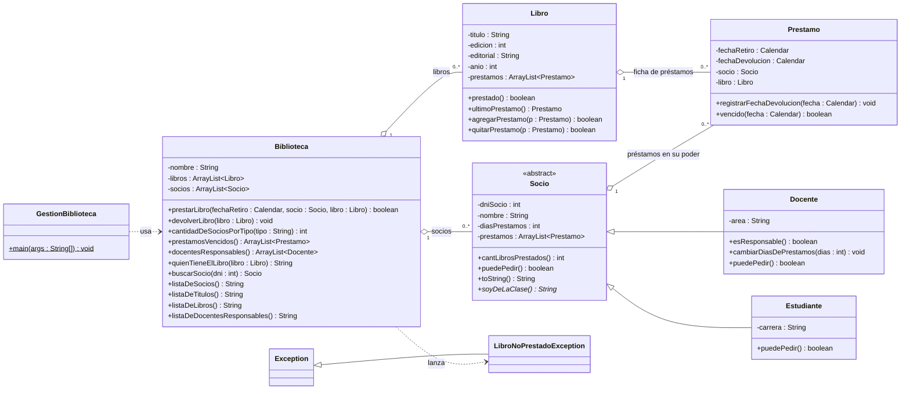

<p align="center">
  
</p>

<h1 align="center">Trabajo Integrador de Programación Orientada a Objetos</h1>
<h2 align="center">Gestión de Biblioteca</h2>

<p align="center">
  <a></a>
  <a></a>
  <a></a>
  <a></a>
  <a></a>
  <a></a>
  <a></a>
</p>

---

## 📑 Índice

- [Sobre el proyecto](#-sobre-el-proyecto)
- [Requisitos y qué incluye](#-requisitos-y-qué-incluye)
- [Diagrama UML](#-diagrama-uml)
- [Estructura del proyecto](#-estructura-del-proyecto)
- [Tecnologías](#-tecnologías)
- [Persistencia SQLite](#-persistencia-sqlite)
- [Cómo correrlo](#-cómo-correrlo)
- [Reglas de negocio](#-reglas-de-negocio-y-decisiones-de-diseño)
- [Demo: salida real](#-demo-salida-real-de-gestionbiblioteca)
- [Roadmap](#-roadmap)

---

## 📖 Sobre el proyecto

El presente repositorio corresponde al Trabajo Integrador de la asignatura **Programación Orientada a Objetos**.

El proyecto consiste en el desarrollo de un sistema de **Gestión de Biblioteca en Java**, destinado a administrar libros, socios y préstamos, contemplando las particularidades de docentes y estudiantes, las fechas de vencimiento, las devoluciones, las sanciones por morosidad y la generación de reportes.

> El sistema evalúa responsabilidad de cada docente, premia a lectores puntuales con más días de préstamo y bloquea morosos.

---

## ✅ Requisitos y qué incluye

Implementación completa del diseño de clases de la consigna:

- **Clases del diseño**: `Biblioteca`, `Socio` (abstracta), `Docente`, `Estudiante`, `Libro`, `Prestamo` y la excepción de negocio `LibroNoPrestadoException`.
- **Reglas de préstamo**: tope de 3 libros para estudiantes, bloqueo total ante un préstamo vencido (socios y docentes), días iniciales 5 (docentes) y 20 (estudiantes).
- **Responsabilidad docente**: un docente es responsable si nunca tuvo en mora ni tiene un préstamo vencido; devolver el mismo día del vencimiento cuenta como a tiempo. La responsabilidad se premia con `cambiarDiasDePrestamos(int)` adicionando días de préstamo.
- **Informes**: cantidad de socios por tipo, libros con préstamo vencido (activos), docentes responsables, títulos sin repetir, y el socio que tiene en su poder determinado libro (`quienTieneElLibro`).
- **Tres formatos de listado** — al carácter, tal cual especifica la consigna (formato1 socios, formato2 libros, formato3 docentes responsables).
- `GestionBiblioteca` con escenario completo que responde las **4 preguntas** del enunciado usando los métodos apropiados.
- **Colecciones genéricas** en todas las clases y todo el código dentro del paquete `biblioteca`.

---

## 🧬 Diagrama UML



---

## 🗂 Estructura del proyecto

```text
tp7ProyectoBlueJ/
├── package.bluej                  ← metadatos del proyecto BlueJ
├── libs/
│   └── sqlite-jdbc-3.54.1.0.jar   ← driver JDBC de SQLite (runtime)
├── sql/
│   └── esquema.sql                ← documentación del esquema (referencia)
├── biblioteca.db                  ← base generada al correr (gitignored)
└── biblioteca/                    ← paquete de trabajo (consigna: "biblioteca")
    ├── Biblioteca.java            ← admin de libros/socios, informes y listados
    ├── Socio.java                 ← abstracta: dni, nombre, días y préstamos
    ├── Docente.java               ← area, esResponsable() y premio de días
    ├── Estudiante.java            ← carrera y tope de 3 libros
    ├── Libro.java                 ← ficha de préstamos del ejemplar (+ id persistente)
    ├── Prestamo.java              ← retiro, devolución, socio y libro (+ id persistente)
    ├── LibroNoPrestadoException.java ← excepción de negocio
    ├── GestionBiblioteca.java     ← clase main con el escenario completo
    ├── GestionPersistencia.java   ← demo del CRUD sobre SQLite
    └── persistencia/              ← capa de persistencia (paquete biblioteca.persistencia)
        ├── ConexionBD.java        ← singleton de conexión + DDL auto-migrado
        ├── DAOException.java      ← excepción unchecked de la capa
        ├── LibroDAO.java          ← CRUD libro
        ├── SocioDAO.java          ← CRUD socio (discriminador Docente/Estudiante)
        ├── PrestamoDAO.java       ← CRUD préstamo (+ reposición en fichas)
        └── BibliotecaDAO.java     ← fachada guardar()/cargar() del agregado raíz
```

---

## 🛠 Tecnologías

- **Java 21** (OpenJDK) + **BlueJ** — núcleo POO del práctico.
- **SQLite + JDBC** — capa de persistencia.
- **JavaFX + AtlantaFX** — GUI con estilos CSS empaquetados (en progreso).

---

## 💾 Persistencia SQLite

Capa `biblioteca.persistencia` con CRUD completo sobre SQLite (patrón DAO + conexión singleton), pensada para que la GUI de JavaFX la consuma tal cual.

**Esquema** (se auto-crea al abrir la base; referencia documental en `sql/esquema.sql`):

| Tabla | Contenido | Detalles |
|---|---|---|
| `biblioteca` | registro raíz | `nombre` (pk text) |
| `libro` | ejemplares | `id` surrogate (autoincrement) |
| `socio` | docentes y estudiantes en una tabla plana | columna discriminador `tipo` + `area`/`carrera` nulos según tipo |
| `prestamo` | préstamos | fecha en epoch millis a medianoche; `fecha_devolucion NULL` = activo |

**Decisiones**:

- **`ConexionBD`** singleton: abre la base, habilita `PRAGMA foreign_keys` y ejecuta el DDL si falta. Los errores JDBC se envuelven en `DAOException` (unchecked) para no contaminar las firmas.
- **Identidad persistente**: `Libro` y `Prestamo` ganaron un campo `id` (`-1` = sin persistir); el DAO inserta y le devuelve el `rowid` autogenerado. `Socio` usa su DNI como clave natural.
- **Upsert por identidad** en `BibliotecaDAO.guardar()`: nuevo objeto → `INSERT`, objeto ya persistido → `UPDATE` (así el premio de días al docente y la devolución de préstamos se persisten re-ejecutando el mismo flujo).
- **`PrestamoDAO.findAll(libros, socios)`** reconstruye el grafo: re-pone cada préstamo en la ficha del libro y del socio, tal como los crea `prestarLibro()` en vivo, para que el negocio siga operando sobre objetos cargados de BD.
- **Reglas de negocio en la base**: FK `prestamo→socio` y `prestamo→libro` (impide borrar con dependencias) y un índice parcial único que garantiza **un solo préstamo activo por ejemplar**.
- **Demo**: `GestionPersistencia` — primera corrida siembra (CREATE), segundas corridas leen el estado persistido (READ) y agregan operaciones de UPDATE y DELETE sobre él; `reset` borra las 3 tablas y re-siembra.

---

## 🚀 Cómo correrlo

**Con BlueJ:** abrir el proyecto `tp7ProyectoBlueJ`, compilar el paquete `biblioteca` y ejecutar el `main` de `GestionBiblioteca` (click derecho sobre la clase → `void main(String[] args)`).

**Por línea de comandos** (JDK 21+), desde `tp7ProyectoBlueJ`:

```bash
javac -d classes biblioteca/*.java biblioteca/persistencia/*.java

# Escenario de la consigna (salida fija del TP7, no toca la base de datos)
java -cp classes biblioteca.GestionBiblioteca escenario

# Menu interactivo: todas las operaciones con persistencia automatica en SQLite
java -cp "classes;libs/sqlite-jdbc-3.54.1.0.jar" biblioteca.GestionBiblioteca

# Demo de persistencia (CRUD logueado por escritura)
java -cp "classes;libs/sqlite-jdbc-3.54.1.0.jar" biblioteca.GestionPersistencia          # 1.a vez: siembra; siguientes: recupera estado
java -cp "classes;libs/sqlite-jdbc-3.54.1.0.jar" biblioteca.GestionPersistencia reset    # borrar todo y re-sembrar

# En Linux/macOS el separador de classpath es ":".
```

**En BlueJ:** cargar el driver una sola vez en *Tools → Preferences → Libraries* y seleccionar `tp7ProyectoBlueJ/libs/sqlite-jdbc-3.54.1.0.jar`; luego click derecho sobre `GestionPersistencia` → `void main(String[] args)`.

---

## 📜 Reglas de negocio y decisiones de diseño

<details>
<summary><strong>Abrir reglas</strong> (evaluación a nivel día, tope 3, premio docente…)</summary>

- **Evaluación a nivel día**: todas las comparaciones de vencimiento normalizan la fecha a medianoche (`HOUR_OF_DAY`/`MINUTE`/`SECOND`/`MILLISECOND` en 0). Consecuencia directa: un préstamo que vence **hoy** todavía está a tiempo, y devolver el **mismo día** del vencimiento cuenta como devolución a tiempo.
- **Rechazo silencioso** en `prestarLibro`: si falta fecha/socio/libro, el libro ya está prestado o el socio no `puedePedir()`, devuelve `false` sin efectos colaterales y sin imprimir; quien llama decide qué mostrar. El diseño del diagrama (firma `boolean`) lo respalda.
- **Tope del estudiante**: `puedePedir()` exige menos de 3 libros en su poder (con `<= 3` podía cerrar el ciclo con 4 libros en mano), más el bloqueo estándar por vencidos.
- **Docente responsable**: nunca tuvo ni tiene un préstamo vencido. Los préstamos **devueltos** se evalúan contra su propia fecha de devolución; los **activos** contra hoy. La responsabilidad se premia sumando días con `cambiarDiasDePrestamos(int)`.
- **Prestamos vencidos**: el informe `prestamosVencidos()` considera **solo préstamos activos** (sin fecha de devolución); un préstamo devuelto tarde no aparece, aunque sí deja al docente como no responsable.
- **Días de préstamo**: docentes nacen con **5** días; estudiantes con **20** (la consigna define el vencimiento "20 días después del retiro").

</details>

---

## 🖨 Demo: salida real de `GestionBiblioteca`

<details>
<summary><strong>Abrir la salida completa</strong> (rechazos, premio, vencidos, 4 preguntas y listados)</summary>

```text
-- Rechazos de prestamo --
Milstein (ya tiene 3 libros) intenta llevarse otro:   false
Paenza (tiene un vencido) intenta llevarse otro:      false

-- Premio a la responsabilidad --
Perez tenia 5 dias de prestamo
Perez ahora tiene 10 dias de prestamo
-- Prestamos vencidos a la fecha --
Retiro: 2026/10/5 - Devolucion: Sin devolver
Libro: Longman. Diccionario Pocket
Socio: Francisco Paenza

1) Cantidad de socios de tipo Estudiante: 2
2) Docentes que nunca adeudaron ni adeudan libros:
Lista de Docentes Responsables:
* D.N.I.: 14524782 || Juan Perez (Docente) || Libros Prestados: 1
* D.N.I.: 10912002 || Maria Alegre (Docente) || Libros Prestados: 0
3) Listas de libros y de socios de la biblioteca:
Lista de Libros:
1) Titulo: Programando con JAVA || Prestado: (Si)
2) Titulo: Longman. Diccionario Pocket || Prestado: (Si)
3) Titulo: Vivir para contarla || Prestado: (Si)
4) Titulo: JAVA. Como Programar || Prestado: (Si)
5) Titulo: JAVA. Como Programar || Prestado: (No)
6) Titulo: Longman. Diccionario Pocket || Prestado: (Si)

Lista de Socios:
1) D.N.I.: 14524782 || Juan Perez (Docente) || Libros Prestados: 1
2) D.N.I.: 17982110 || Juan Fernandez (Docente) || Libros Prestados: 0
3) D.N.I.: 10912002 || Maria Alegre (Docente) || Libros Prestados: 0
4) D.N.I.: 28987498 || Francisco Paenza (Estudiante) || Libros Prestados: 1
5) D.N.I.: 31987123 || Cesar Milstein (Estudiante) || Libros Prestados: 3

**************************************
Cantidad de Socios del tipo Estudiante: 2
Cantidad de Socios del tipo Docente: 3
**************************************
4) El libro "Programando con JAVA" lo tiene: Juan Perez
```

</details>

---

## 🧭 Roadmap

- [ ] **Persistencia con SQLite**: ✔ conexión (+ DDL auto-migrado), DAOs con CRUD completo (insert/update/delete/find) y demo `GestionPersistencia`.
- [ ] **GUI con JavaFX + AtlantaFX**: interfaz gráfica sobre la capa DAO con estilos CSS empaquetados.
- [ ] **Empaquetado final**: distribución del proyecto con las tres capas integradas.

---

<footer>

<p align="center">
  <em>Trabajo Integrador · Programación Orientada a Objetos · Java</em>
</p>

<p align="center">
  
</p>

</footer>
