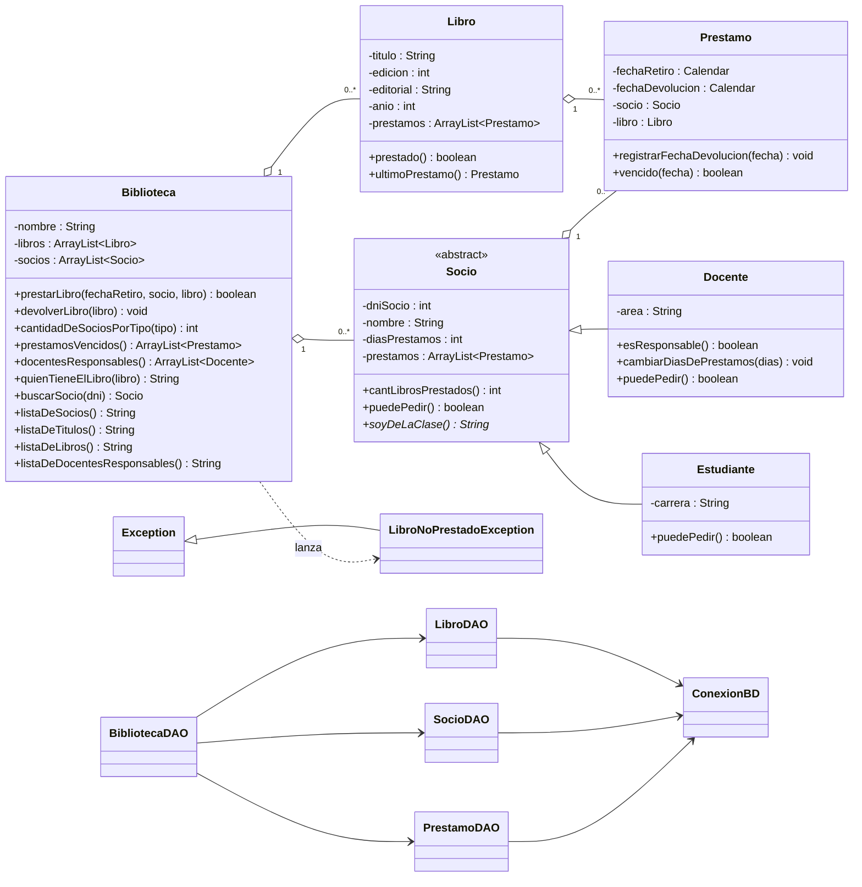
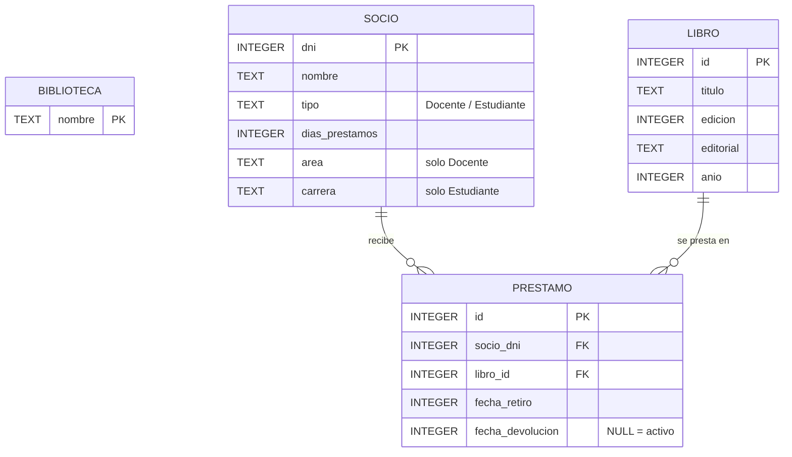

<p align="center">
  
</p>

<h1 align="center">Trabajo Integrador de Programación Orientada a Objetos</h1>
<h2 align="center">MiBiblioteca · Sistema de Gestión de Biblioteca</h2>

<p align="center">
  
  
  
  
  
</p>

---

## 📑 Índice

- [Sobre el proyecto](#-sobre-el-proyecto)
- [Funcionalidades](#-funcionalidades)
- [Cómo correrlo](#-cómo-correrlo)
- [Diagrama de clases (UML)](#-diagrama-de-clases-uml)
- [Estructura del repositorio](#-estructura-del-repositorio)
- [Tecnologías](#-tecnologías)
- [Persistencia con SQLite](#-persistencia-con-sqlite)
- [Interfaz gráfica](#-interfaz-gráfica)
- [Reglas de negocio](#-reglas-de-negocio-y-decisiones-de-diseño)
- [Demo: salida real de la consola](#-demo-salida-real-de-gestionbiblioteca)
- [Documentación](#-documentación)
- [Roadmap](#-roadmap)

---

## 📖 Sobre el proyecto

Este repositorio contiene el Trabajo Integrador de la asignatura **Programación Orientada a Objetos**.

Es un sistema de **gestión de biblioteca en Java** que administra libros, socios y préstamos. Contempla las particularidades de docentes y estudiantes, las fechas de vencimiento, las devoluciones, las sanciones por morosidad y la generación de informes.

El proyecto creció en tres etapas: el **núcleo POO** (consola), la **persistencia** con SQLite + JDBC y una **interfaz gráfica** con Java Swing. Las tres capas conviven en un mismo paquete, `MiBiblioteca`, y se pueden usar tanto desde consola como desde la GUI.

> El sistema evalúa la responsabilidad de cada docente, premia a los lectores puntuales con más días de préstamo y bloquea a los morosos.

---

## ✅ Funcionalidades

- **Socios:** alta de docentes y estudiantes, consulta de datos y búsqueda por D.N.I.
- **Catálogo:** alta y gestión de libros (ejemplares) y consulta de disponibilidad.
- **Préstamos:** retiro de un libro por un socio, validando las condiciones de cada tipo de socio.
- **Devoluciones:** registro de la devolución y actualización del estado del préstamo.
- **Vencimientos:** detección de préstamos vencidos y bloqueo de nuevos préstamos a morosos.
- **Consultas:** búsqueda de socios y de quién tiene en su poder un determinado libro.
- **Informes y estadísticas:** cantidad de socios por tipo, vencidos, docentes responsables, títulos sin repetir y listados con formato.
- **Persistencia:** todo se guarda en SQLite y se conserva entre ejecuciones.
- **Datos iniciales:** `CargadorDeDatosIniciales` siembra registros de prueba.
- **Temas visuales** en la GUI y pantalla de carga al iniciar.

---

## 🚀 Cómo correrlo

**Requisitos:** JDK 21 y [BlueJ](https://www.bluej.org/).

1. Clonar o descargar el repositorio.
2. Abrir con BlueJ la carpeta **`Tp7IntegradorBluej`** (*Project → Open Project*).
3. Compilar el proyecto (*Compile*). El driver JDBC de SQLite ya viene en `Tp7IntegradorBluej/+libs/`: BlueJ carga automáticamente los `.jar` de esa carpeta, no hace falta configurar nada.
4. Click derecho sobre la clase que quieras ejecutar → `void main(String[] args)`:

| Modo | Clase principal |
|---|---|
| **Consola (CLI)** | `GestionBiblioteca` |
| **Interfaz gráfica (Swing)** | `VentanaPrincipal` |

La base `biblioteca.db` se crea y se siembra con datos de prueba la primera vez que se ejecuta.

---

## 🧬 Diagrama de clases (UML)



---

## 🗂 Estructura del repositorio

```text
integrador-poo/
├── README.md
├── schema.sql                       ← esquema DDL de la base de datos
├── docs/
│   ├── diagrama-er.md               ← diagrama entidad-relación de la base
│   ├── diagrama-er.png
│   ├── informe-tecnico.md           ← informe técnico (arquitectura, persistencia y GUI)
│   └── Ficha Autoevaluacion Grupo Los NullPointerException.pdf
└── Tp7IntegradorBluej/              ← proyecto BlueJ (abrir esta carpeta)
    ├── package.bluej
    ├── biblioteca.db                ← base de prueba SQLite
    ├── +libs/
    │   └── sqlite-jdbc-3.54.1.0.jar ← driver JDBC (BlueJ lo carga solo)
    ├── Tp7ProyectoEjecutable.jar
    └── MiBiblioteca/                ← paquete con todo el código
        │
        │  ── Modelo (núcleo POO) ──
        ├── Biblioteca.java
        ├── Socio.java               ← abstracta
        ├── Docente.java
        ├── Estudiante.java
        ├── Libro.java
        ├── Prestamo.java
        ├── LibroNoPrestadoException.java
        │
        │  ── Persistencia (SQLite + JDBC) ──
        ├── ConexionBD.java
        ├── BibliotecaDAO.java
        ├── LibroDAO.java
        ├── SocioDAO.java
        ├── PrestamoDAO.java
        ├── CargadorDeDatosIniciales.java
        ├── TrabajoBD.java
        │
        │  ── Consola ──
        ├── GestionBiblioteca.java   ← main CLI
        │
        │  ── Interfaz gráfica (Swing) ──
        ├── VentanaPrincipal.java    ← main GUI
        ├── VentanaSociosDocentes.java
        ├── VentanaSociosEstudiantes.java
        ├── VentanaListaSocios.java
        ├── VentanaCatalogo.java
        ├── VentanaGestionLibros.java
        ├── VentanaListaLibros.java
        ├── VentanaPrestamos.java
        ├── VentanaDevoluciones.java
        ├── VentanaConsultas.java
        ├── VentanaEstadisticas.java
        ├── VentanaInforme.java
        ├── PantallaCarga.java
        ├── BotonRedondeado.java
        ├── GestorTemas.java
        ├── UtilidadesInterfaz.java
        ├── UtilidadesPrestamos.java
        └── RenderizadorEstadoPrestamo.java
```

---

## 🛠 Tecnologías

- **Java 21** (OpenJDK): lenguaje de todo el sistema.
- **Java Swing** (JDK nativo, sin dependencias extra): ventanas, formularios, tablas y botones.
- **SQLite + JDBC** (`sqlite-jdbc 3.54.1.0`): almacenamiento de datos.
- **BlueJ**: entorno de desarrollo del trabajo práctico.
- **GitHub** y **Trello**: código y organización de tareas.

---

## 💾 Persistencia con SQLite

Capa de persistencia con patrón **DAO** y conexión **singleton**. Las operaciones SQL quedan separadas de la lógica del negocio.

| Clase | Responsabilidad |
|---|---|
| `ConexionBD` | Abre la conexión, habilita las claves foráneas y crea las tablas si faltan. |
| `BibliotecaDAO` | Fachada: carga y guarda el conjunto completo de datos. |
| `LibroDAO` | CRUD de libros. |
| `SocioDAO` | CRUD de docentes y estudiantes. |
| `PrestamoDAO` | CRUD de préstamos y devoluciones; reconstruye las fichas de libros y socios al cargar. |
| `CargadorDeDatosIniciales` | Siembra datos de prueba. |

**Decisiones principales:**

- **Identidad persistente:** `Libro` y `Prestamo` tienen un `id` autogenerado (`-1` = todavía no persistido). `Socio` usa su D.N.I. como clave natural.
- **Upsert por identidad:** objeto nuevo → `INSERT`; objeto ya persistido → `UPDATE`.
- **Reglas del negocio en la base:** claves foráneas restrictivas y un índice parcial único que garantiza **un solo préstamo activo por ejemplar**.
- **Herencia en una sola tabla:** docentes y estudiantes comparten la tabla `socio`, diferenciados por la columna `tipo`.
- **Fechas** guardadas como epoch millis a medianoche (comparación a nivel día).

### Diagrama entidad-relación



Detalle completo (restricciones, modelo relacional): [`docs/diagrama-er.md`](docs/diagrama-er.md).

---

## 🖥 Interfaz gráfica

Interfaz construida con **Java Swing**, sin librerías externas. `VentanaPrincipal` es el punto de entrada y, desde el menú lateral, da acceso a cada sección:

| Sección | Ventanas | Funcionalidad |
|---|---|---|
| Socios | `VentanaSociosDocentes`, `VentanaSociosEstudiantes`, `VentanaListaSocios` | Alta y consulta de docentes y estudiantes. |
| Catálogo | `VentanaCatalogo`, `VentanaGestionLibros`, `VentanaListaLibros` | Alta, gestión y listado de libros con su disponibilidad. |
| Préstamos | `VentanaPrestamos` | Retiro de libros y control de condiciones. |
| Devoluciones | `VentanaDevoluciones` | Registro de devoluciones. |
| Consultas | `VentanaConsultas` | Búsqueda de socios y de quién tiene cada libro. |
| Estadísticas | `VentanaEstadisticas`, `VentanaInforme` | Informes y datos generales de la biblioteca. |

**Detalles de diseño:** pantalla de carga (`PantallaCarga`), botones redondeados personalizados (`BotonRedondeado`), cuatro temas visuales (azul, oscuro, rosa y rojo) administrados por `GestorTemas`, y un renderizador propio para el estado de los préstamos en las tablas.

---

## 📜 Reglas de negocio y decisiones de diseño

<details>
<summary><strong>Ver reglas</strong></summary>

- **Días de préstamo:** los docentes parten con **5** días y los estudiantes con **20**.
- **Tope del estudiante:** máximo **3** libros en su poder.
- **Bloqueo por vencidos:** un socio (docente o estudiante) con un préstamo vencido no puede pedir nuevos libros.
- **Un ejemplar, un préstamo activo:** no se puede prestar un libro que ya está prestado.
- **Evaluación a nivel día:** las fechas se normalizan a medianoche. Un préstamo que vence **hoy** todavía está a tiempo, y devolver el **mismo día** del vencimiento cuenta como devolución a tiempo.
- **Docente responsable:** nunca tuvo ni tiene un préstamo vencido. Los préstamos devueltos se evalúan contra su fecha de devolución y los activos contra la fecha actual. La responsabilidad se premia sumando días con `cambiarDiasDePrestamos(int)`.
- **Préstamos vencidos (informe):** considera solo los préstamos **activos**. Uno devuelto tarde no aparece, pero deja al docente como no responsable.
- **Rechazo silencioso:** `prestarLibro` devuelve `false` sin efectos colaterales cuando no se puede prestar; quien llama decide qué mostrar.
- **Bajas protegidas:** no se puede borrar un socio o libro con historial de préstamos (claves foráneas restrictivas).

</details>

---

## 🖨 Demo: salida real de `GestionBiblioteca`

<details>
<summary><strong>Ver salida completa</strong> (rechazos, premio, vencidos, las 4 preguntas y listados)</summary>

```text
-- Rechazos de prestamo --
Milstein (ya tiene 3 libros) intenta llevarse otro:   false
Paenza (tiene un vencido) intenta llevarse otro:      false

-- Premio a la responsabilidad --
Perez tenia 5 dias de prestamo
Perez ahora tiene 10 dias de prestamo
-- Prestamos vencidos a la fecha --
Retiro: 2026/10/5 - Devolucion: Sin devolver
Libro: Longman. Diccionario Pocket
Socio: Francisco Paenza

1) Cantidad de socios de tipo Estudiante: 2
2) Docentes que nunca adeudaron ni adeudan libros:
Lista de Docentes Responsables:
* D.N.I.: 14524782 || Juan Perez (Docente) || Libros Prestados: 1
* D.N.I.: 10912002 || Maria Alegre (Docente) || Libros Prestados: 0
3) Listas de libros y de socios de la biblioteca:
Lista de Libros:
1) Titulo: Programando con JAVA || Prestado: (Si)
2) Titulo: Longman. Diccionario Pocket || Prestado: (Si)
3) Titulo: Vivir para contarla || Prestado: (Si)
4) Titulo: JAVA. Como Programar || Prestado: (Si)
5) Titulo: JAVA. Como Programar || Prestado: (No)
6) Titulo: Longman. Diccionario Pocket || Prestado: (Si)

Lista de Socios:
1) D.N.I.: 14524782 || Juan Perez (Docente) || Libros Prestados: 1
2) D.N.I.: 17982110 || Juan Fernandez (Docente) || Libros Prestados: 0
3) D.N.I.: 10912002 || Maria Alegre (Docente) || Libros Prestados: 0
4) D.N.I.: 28987498 || Francisco Paenza (Estudiante) || Libros Prestados: 1
5) D.N.I.: 31987123 || Cesar Milstein (Estudiante) || Libros Prestados: 3

**************************************
Cantidad de Socios del tipo Estudiante: 2
Cantidad de Socios del tipo Docente: 3
**************************************
4) El libro "Programando con JAVA" lo tiene: Juan Perez
```

</details>

---

## 📚 Documentación

- [Consigna del trabajo](consigna-poo.md)
- [Informe técnico](docs/informe-tecnico.md): arquitectura, persistencia y GUI explicadas capa por capa.
- [Diagrama entidad-relación](docs/diagrama-er.md)
- [Ficha de autoevaluación del grupo](docs/Ficha%20Autoevaluacion%20Grupo%20Los%20NullPointerException.pdf)

---

## 🧭 Roadmap

- [x] **Núcleo POO:** modelo de clases, reglas de préstamo e informes por consola.
- [x] **Persistencia con SQLite:** conexión, DAOs con CRUD completo y datos iniciales.
- [x] **Interfaz gráfica con Swing:** ventanas para socios, catálogo, préstamos, devoluciones, consultas y estadísticas.
- [x] **Empaquetado final:** proyecto con las tres capas integradas y jar ejecutable.

---

<p align="center">
  <em>Trabajo Integrador · Programación Orientada a Objetos · Java</em>
</p>
