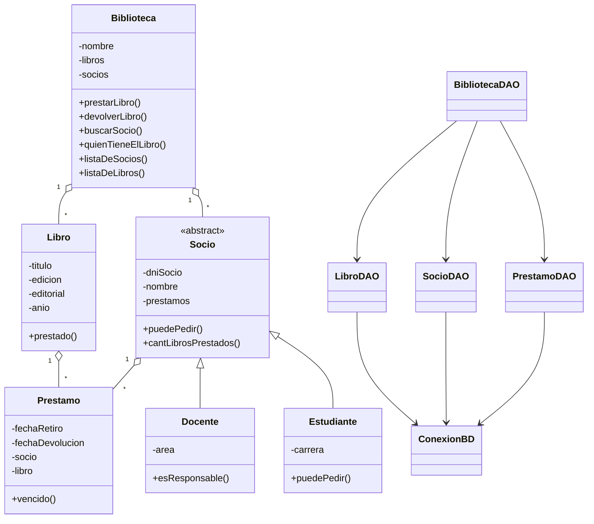

 <p align="center">
  
</p>

<h1 align="center">Trabajo Integrador de Programación Orientada a Objetos</h1>
<h2 align="center">MiBiblioteca - Sistema de Gestión de Biblioteca</h2>

<p align="center">
  
  
  
  
  
</p>

---

## 📑 Índice

- [Sobre el proyecto](#-sobre-el-proyecto)
- [Objetivos y funcionalidades](#-objetivos-y-funcionalidades)
- [Organización del sistema](#-organización-del-sistema)
- [Tecnologías utilizadas](#-tecnologías-utilizadas)
- [Persistencia con SQLite](#-persistencia-con-sqlite)
- [Interfaz gráfica](#-interfaz-gráfica)
- [Espacio de trabajo en Trello](#-espacio-de-trabajo-en-trello)
- [Cómo ejecutar el proyecto](#-cómo-ejecutar-el-proyecto)
- [Reglas de funcionamiento](#-reglas-de-funcionamiento)
- [Conclusión](#-conclusión)

---

## 📖 Sobre el proyecto

Este repositorio contiene nuestro Trabajo Integrador de la materia **Programación Orientada a Objetos**.

El proyecto consiste en desarrollar un sistema de gestión para una biblioteca utilizando Java. La idea es poder administrar los libros, registrar socios, realizar préstamos y devoluciones, consultar información y generar estadísticas.

El sistema contempla dos tipos de socios: docentes y estudiantes. Cada uno tiene sus propias características y condiciones para solicitar libros.

A medida que fuimos avanzando con el trabajo, también incorporamos una interfaz gráfica para que el uso del programa fuera más sencillo y cómodo, además de una base de datos SQLite para guardar la información y conservarla entre ejecuciones.

---

## ✅ Objetivos y funcionalidades

El objetivo principal fue construir un programa que permita gestionar las actividades habituales de una biblioteca y aplicar los conceptos de Programación Orientada a Objetos vistos durante la cursada.

Entre las funcionalidades que desarrollamos se encuentran:

- **Gestión de socios:** permite registrar docentes y estudiantes, consultar sus datos y buscar socios mediante su DNI.
- **Catálogo de libros:** permite agregar libros, consultar los ejemplares registrados y conocer su disponibilidad.
- **Préstamos:** permite registrar el préstamo de un libro a un socio, teniendo en cuenta las condiciones correspondientes.
- **Devoluciones:** permite registrar la devolución de libros y actualizar el estado de los préstamos.
- **Control de vencimientos:** permite identificar préstamos vencidos y aplicar las restricciones correspondientes.
- **Consultas:** permite buscar información de socios y consultar quién tiene un determinado libro.
- **Estadísticas e informes:** presenta información general de la biblioteca, listados de socios y libros, y datos relacionados con los préstamos.
- **Persistencia:** los datos se guardan en una base SQLite para que no se pierdan al cerrar el programa.
- **Datos iniciales:** incorporamos un cargador para disponer de registros de prueba al preparar la biblioteca.

---

## 🧬 Organización del sistema

Para organizar el código tratamos de separar las responsabilidades de cada clase.

La clase `Biblioteca` se encarga de la lógica principal del sistema y de relacionar los libros, los socios y los préstamos.

La clase `Socio` representa los datos y comportamientos comunes. A partir de ella se encuentran `Docente` y `Estudiante`, que tienen sus propias características.

Por otro lado, `Libro` representa los ejemplares disponibles y `Prestamo` almacena la información relacionada con cada operación.

También separamos el acceso a la base de datos mediante clases DAO, para evitar mezclar las operaciones de SQLite con la lógica principal del programa.

### Diagrama general de clases



---

## 🗂 Estructura del proyecto

El proyecto está organizado dentro del paquete `MiBiblioteca`. Las clases se encuentran separadas según la tarea que realizan.

```text
MiBiblioteca/
│
├── GestionBiblioteca.java
│
├── Biblioteca.java
├── Socio.java
├── Docente.java
├── Estudiante.java
├── Libro.java
├── Prestamo.java
│
├── ConexionBD.java
├── BibliotecaDAO.java
├── LibroDAO.java
├── SocioDAO.java
├── PrestamoDAO.java
│
├── CargadorDeDatosIniciales.java
│
├── VentanaPrincipal.java
├── VentanaSociosDocentes.java
├── VentanaSociosEstudiantes.java
├── VentanaListaSocios.java
├── VentanaCatalogo.java
├── VentanaPrestamos.java
├── VentanaDevoluciones.java
├── VentanaEstadisticas.java
├── VentanaConsultas.java
│
├── PantallaCarga.java
├── PanelCapibara.java
├── BotonRedondeado.java
├── GestorTemas.java
├── UtilidadesInterfaz.java
├── UtilidadesPrestamos.java
└── RenderizadorEstadoPrestamo.java
```

La organización puede incluir otras clases auxiliares y excepciones utilizadas por el proyecto.

---

## 🛠 Tecnologías utilizadas

- **Java:** lenguaje utilizado para desarrollar toda la lógica del sistema.
- **Java Swing:** biblioteca utilizada para construir las ventanas, formularios, tablas y botones de la interfaz gráfica.
- **SQLite:** motor de base de datos utilizado para almacenar la información.
- **JDBC:** conexión entre Java y SQLite.
- **BlueJ:** entorno de desarrollo utilizado durante el trabajo práctico.
- **GitHub:** repositorio para guardar y compartir el código del proyecto.
- **Trello:** herramienta utilizada para organizar las tareas y el avance del trabajo.

---

## 💾 Persistencia con SQLite

Una de las partes importantes del proyecto fue incorporar una base de datos para poder conservar la información de la biblioteca.

Para esto utilizamos SQLite junto con JDBC.

La conexión se realiza mediante `ConexionBD`, mientras que las clases DAO se encargan de las operaciones correspondientes a cada tipo de dato.

La persistencia está organizada de la siguiente manera:

| Clase | Responsabilidad |
|---|---|
| `ConexionBD` | Establece la conexión con SQLite y prepara las tablas. |
| `BibliotecaDAO` | Coordina la carga y el guardado de la información. |
| `LibroDAO` | Guarda y recupera los libros. |
| `SocioDAO` | Guarda y recupera docentes y estudiantes. |
| `PrestamoDAO` | Registra los préstamos y sus devoluciones. |

De esta manera, cuando se realizan operaciones desde el programa, los cambios también se guardan en la base de datos.

Esto permite cerrar y volver a abrir la aplicación sin tener que cargar nuevamente toda la información.

---

## 🖥 Interfaz gráfica

Además de la parte de consola, desarrollamos una interfaz gráfica utilizando Java Swing.

La ventana principal funciona como punto de acceso a las distintas secciones de la biblioteca. Desde el menú lateral se puede ingresar a cada una de las funcionalidades.

### Secciones de la aplicación

| Sección | Funcionalidad |
|---|---|
| Inicio | Pantalla principal de bienvenida. |
| Socios | Registro y consulta de docentes y estudiantes. |
| Catálogo | Administración y consulta de libros. |
| Préstamos | Registro y consulta de préstamos. |
| Devoluciones | Registro de devoluciones. |
| Estadísticas | Consulta de información y generación de informes. |
| Consultas | Búsqueda de información sobre los libros y sus préstamos. |

### Diseño de la aplicación

También trabajamos en algunos detalles visuales para que la aplicación tuviera una apariencia más cuidada:

- Pantalla de carga al iniciar el programa.
- Menú lateral para navegar entre las secciones.
- Botones redondeados personalizados.
- Panel de bienvenida con un capibara bibliotecario.
- Cuatro temas visuales: azul, oscuro, rosa y rojo.
- Tablas y formularios para mostrar y cargar información.

La idea fue mantener una interfaz sencilla, donde las opciones principales estuvieran siempre a mano y las operaciones fueran fáciles de encontrar.

---

## 📋 Espacio de trabajo en Trello

Para organizarnos durante el desarrollo del trabajo utilizamos Trello como espacio de planificación.

Allí podemos organizar las tareas, registrar qué actividades están pendientes, cuáles se encuentran en proceso y cuáles ya fueron terminadas.

También nos sirve para llevar un seguimiento de los cambios que vamos realizando y tener una visión general del avance del proyecto.

<p align="center">
  <a href="https://trello.com/b/xPFlwiGt/proyecto-integrador-unne">
    
  </a>
</p>

**Tablero del proyecto:** [Proyecto Integrador UNNE](https://trello.com/b/xPFlwiGt/proyecto-integrador-unne)

---

## 🚀 Cómo ejecutar el proyecto

Para ejecutar el programa es necesario contar con Java instalado y tener disponible el controlador JDBC de SQLite.

Los pasos generales son:

1. Descargar o clonar el repositorio.
2. Abrir el proyecto desde BlueJ.
3. Verificar que la biblioteca del controlador SQLite esté agregada al proyecto.
4. Compilar las clases.
5. Ejecutar la clase `GestionBiblioteca`, que contiene el método `main`.

Al iniciar el programa se prepara la conexión con SQLite, se carga la información correspondiente y se abre la aplicación.

---

## 📜 Reglas de funcionamiento

El sistema contempla algunas condiciones para que las operaciones de la biblioteca se realicen correctamente:

- Los socios se diferencian entre docentes y estudiantes.
- Cada tipo de socio tiene sus propias condiciones para solicitar libros.
- No se permite prestar un ejemplar que ya se encuentre prestado.
- Se controlan las fechas de retiro y vencimiento de cada préstamo.
- Los socios con préstamos vencidos tienen restricciones para solicitar nuevos libros.
- Las devoluciones actualizan el estado del préstamo.
- Se puede consultar quién tiene actualmente un determinado ejemplar.
- Los informes permiten consultar la situación de los socios, los libros y los préstamos.

Estas reglas se encuentran distribuidas entre las clases del modelo, principalmente en `Biblioteca`, `Socio`, `Docente`, `Estudiante`, `Libro` y `Prestamo`.

---

## 🎓 Conclusión
En este  trabajo pudimos aplicar los conceptos de Programación Orientada a Objetos  aprendidos en la catedra en un proyecto más completo, pasando de trabajar sin persistencia de datos ni interfaz a integrarlos con las librerias javax.swing.* e java.sql.Connection.

Durante el desarrollo trabajamos con herencia, encapsulamiento, colecciones, relaciones entre objetos, excepciones, persistencia con SQLite y construcción de interfaces gráficas con Java Swing.

También aprendimos a organizar mejor el código, separar responsabilidades y reutilizar métodos para evitar repetir lógica.

El resultado es una aplicación que permite gestionar las operaciones principales de una biblioteca y conservar la información mediante una base de datos.

---

<p align="center">
  <em>Trabajo Integrador · Programación Orientada a Objetos · Java</em>
</p>

<p align="center">
  
</p>
