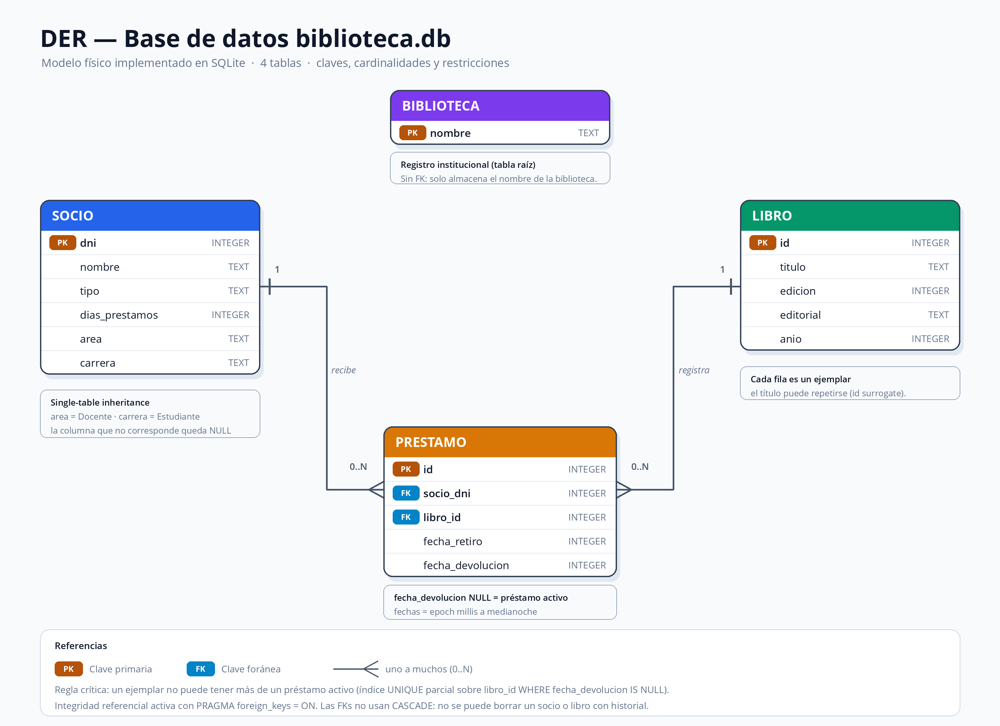
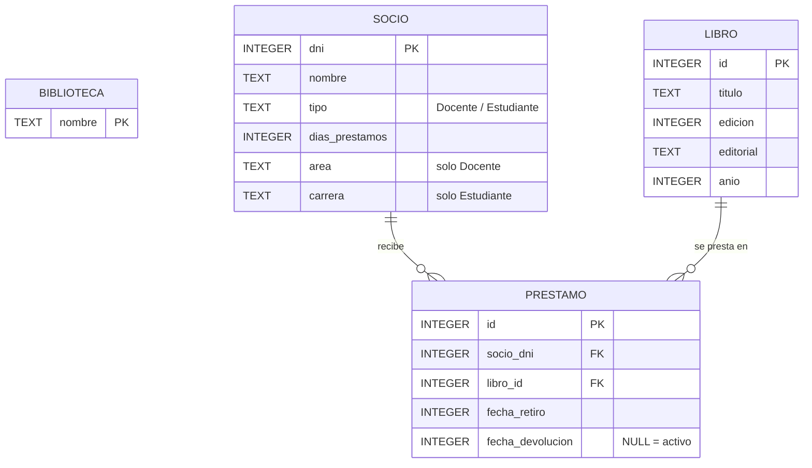

# Diagrama Entidad-Relación — base `biblioteca.db`

> Proyecto: **Gestión de Biblioteca** (TP7 / POO)
> Motor: SQLite · Fuente del esquema: `tp7ProyectoBlueJ/sql/esquema.sql` y `ConexionBD.DDL`.



## 1. DER conceptual



Lectura de cardinalidades:

- **SOCIO (1) ─── (0..N) PRESTAMO**: un socio puede tener muchos préstamos; cada préstamo pertenece a exactamente un socio (`socio_dni NOT NULL`).
- **LIBRO (1) ─── (0..N) PRESTAMO**: un ejemplar acumula historial de préstamos; cada préstamo referencia exactamente un libro (`libro_id NOT NULL`).
- **Préstamo activo por libro: 0..1**. No se puede expresar en Mermaid; lo garantiza el índice parcial único.
- **BIBLIOTECA** no tiene claves foráneas: es la tabla raíz o registro institucional (solo `nombre`).

> **Especialización de `socio`:** no hay tablas separadas. Se usa *single-table inheritance*:
> `tipo = 'Docente'` utiliza `area`; `tipo = 'Estudiante'` utiliza `carrera`. La columna que no corresponde queda `NULL`.

## 2. Modelo relacional (esquema físico)

```text
biblioteca(nombre PK)

libro(id PK, titulo NOT NULL, edicion NOT NULL, editorial NOT NULL, anio NOT NULL)

socio(dni PK,
      nombre NOT NULL,
      tipo NOT NULL CHECK (tipo IN ('Docente','Estudiante')),
      dias_prestamos NOT NULL,
      area NULL,          -- solo Docente
      carrera NULL)       -- solo Estudiante

prestamo(id PK,
         socio_dni NOT NULL FK -> socio(dni),
         libro_id  NOT NULL FK -> libro(id),
         fecha_retiro NOT NULL,
         fecha_devolucion NULL)   -- NULL = préstamo activo
```

## 3. Restricciones implementadas en la base

| Restricción | Implementación |
|---|---|
| Integridad referencial | `PRAGMA foreign_keys = ON` al abrir la conexión |
| No borrar socio/libro con historial | FKs sin `ON DELETE CASCADE` (comportamiento restrictivo) |
| Un solo préstamo activo por ejemplar | `UNIQUE INDEX idx_libro_un_prestamo_activo ON prestamo(libro_id) WHERE fecha_devolucion IS NULL` |
| Tipo de socio válido | `CHECK (tipo IN ('Docente','Estudiante'))` |
| Fechas | `INTEGER` con epoch millis a medianoche (comparación por día) |
