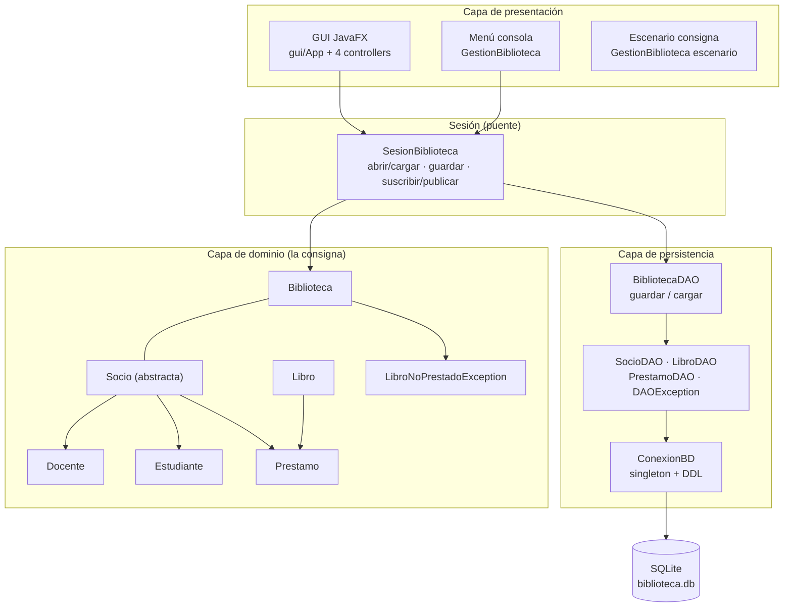
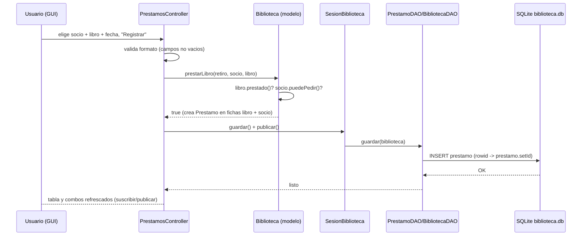

# Informe Técnico — Gestión de Biblioteca

> Trabajo Integrador de Programación Orientada a Objetos · TP7
> Java 21 · SQLite (JDBC) · JavaFX + AtlantaFX
> Equipo 49 / proyecto `integrador-poo` (rama `main`)

Este documento explica **cómo funciona absolutamente todo el sistema**, capa por
capa, con el recorrido de datos de punta a punta. Está armado para **defensa oral**:
cada sección cierra con los "puntos clave para explicar".

---

## Índice

1. [¿Qué hace el sistema?](#1-qué-hace-el-sistema)
2. [Arquitectura en capas](#2-arquitectura-en-capas)
3. [Capa de dominio (la consigna del TP7)](#3-capa-de-dominio-la-consigna-del-tp7)
4. [Capa de persistencia (SQLite + JDBC)](#4-capa-de-persistencia-sqlite--jdbc)
5. [Capa de presentación: GUI JavaFX](#5-capa-de-presentación-gui-javafx)
6. [Capa de presentación: menú de consola](#6-capa-de-presentación-menú-de-consola)
7. [El recorrido completo de una operación (punta a punta)](#7-el-recorrido-completo-de-una-operación-punta-a-punta)
8. [Cómo se corre el sistema](#8-cómo-se-corre-el-sistema)
9. [Pruebas y evidencias](#9-pruebas-y-evidencias)
10. [Decisiones de diseño y por qué](#10-decisiones-de-diseño-y-por-qué)
11. [Preguntas probables del tribunal (FAQ)](#11-preguntas-probables-del-tribunal-faq)

---

## 1. ¿Qué hace el sistema?

Una biblioteca administra **libros (ejemplares), socios (docentes y estudiantes)
y préstamos**, con las reglas de la consigna y agregando persistencia real y una
interfaz gráfica:

- **Reglas de negocio del TP7**: tope de 3 libros para estudiantes, bloqueo
  cuando hay préstamos vencidos (5 días docente / 20 días estudiante),
  docentes responsables con premio de días, y las 4 preguntas con los 3
  formatos de listado exactos.
- **Persistencia SQLite**: todo lo que se hace queda guardado en
  `biblioteca.db` (CRUD completo con DAOs).
- **GUI con JavaFX**: ventana con 4 pestañas (Socios / Libros / Préstamos /
  Informes) sobre la misma base.
- **Menú de consola** (`GestionBiblioteca`): todas las operaciones también en
  modo texto, y el **escenario de la consigna** que responde las 4 preguntas
  con salida fija.

Las tres interfaces de uso (GUI, consola, escenario) operan sobre **el mismo
modelo y la misma base**: es la misma aplicación con tres "caras".

---

## 2. Arquitectura en capas



**Por qué está separada en capas**

- El **dominio** es exactamente el diseño pedido por la consigna (clases puras).
  No sabe nada de SQL ni de JavaFX → es reutilizable y testable solo.
- La **persistencia** solo traduce objetos ↔ filas. Si mañana la base fuera
  MySQL, no cambia ni una línea del dominio.
- La **presentación** (GUI/consola) no toca SQL directo: pide cosas al modelo y
  avisa "guardá" a la sesión. Si mañana se cambia el front, no cambia nada de lo
  demás.

**Puntos clave para explicar**: *"Las reglas del negocio son del modelo; la base
guarda; la pantalla muestra. Cada capa solo conoce a la de abajo."*

---

## 3. Capa de dominio (la consigna del TP7)

Paquete `biblioteca`, colecciones genéricas (`ArrayList<Socio>`, `ArrayList<Prestamo>`…).

### Clases y responsabilidades

| Clase | Qué representa | Operaciones de negocio |
|---|---|---|
| `Biblioteca` | El agregado raiz: nombre + colección de libros y socios | `prestarLibro`, `devolverLibro`, `quienTieneElLibro`, `prestamosVencidos`, `docentesResponsables`, `cantidadDeSociosPorTipo`, `buscarSocio`, los 4 listados |
| `Socio` (abstracta) | dni, nombre, días de préstamo, lista de préstamos | `cantLibrosPrestados`, `puedePedir` (sin vencidos), `soyDeLaClase` (abstracto) |
| `Docente` | + `area` | `esResponsable` (nunca adeudó), `cambiarDiasDePrestamos` (premio), redefinición de `puedePedir` |
| `Estudiante` | + `carrera` | `puedePedir`: sin vencidos **y** menos de 3 libros |
| `Libro` | Ejemplar: título, edición, editorial, año, ficha de préstamos, `id` | `prestado` (tiene préstamo sin devolución), `ultimoPrestamo` |
| `Prestamo` | Retiro + devolución (+ socio, libro, `id`) | `registrarFechaDevolucion`, `vencido(fecha)` |
| `LibroNoPrestadoException` | Excepción de negocio (checked) | usada por `devolverLibro` y `quienTieneElLibro` |

### Reglas de negocio implementadas (y cómo explicarlas)

1. **Evaluación a nivel día**: todas las fechas se normalizan a medianoche
   (`HOUR_OF_DAY/MIN/SEC/MILLIS = 0`). Consecuencia: un préstamo que vence
   **hoy** todavía está a tiempo y devolver el **mismo día del vencimiento**
   cuenta como a tiempo. (`SesionBiblioteca.fecha/hoy` y los normalizadores del
   modelo comparten este criterio.)
2. **Tope del estudiante**: `puedePedir()` exige **menos de 3** libros, más el
   bloqueo estándar por préstamos vencidos. Con `<=` podría cerrar el ciclo con
   4 libros en mano.
3. **Docente responsable**: recorre su historial; los **devueltos** se evalúan
   contra su propia fecha de devolución (¿entregó tarde?) y los **activos**
   contra hoy. Si algo quedó vencido → no responsable.
4. **Premio**: `cambiarDiasDePrestamos(int)` **suma** días al docente → más plazo
   para futuros préstamos (se refleja en `Prestamo.vencido`, que hoy usa
   `socio.getDiasPrestamos()`).
5. **`prestamosVencidos()`**: devuelve solo préstamos **activos** vencidos (un
   préstamo devuelto tarde no figura, aunque sí deja al docente como no
   responsable).
6. **Rechazo silencioso** en `prestarLibro`: devuelve `boolean` sin imprimir —
   la consigna pide esa firma; quién llama decide qué mostrar (menú/GUI traducen
   a mensajes).
7. **Excepción de negocio**: `devolverLibro` y `quienTieneElLibro` lanzan
   `LibroNoPrestadoException` con los mensajes literales de la consigna.

**Puntos clave para explicar**: *"El modelo no imprime ni consulta la base:
esas reglas funcionan igual en consola, en la GUI y en el escenario."*

---

## 4. Capa de persistencia (SQLite + JDBC)

Paquete `biblioteca.persistencia`. Motor: **SQLite** (archivo único,
sin servidor) accedido con **JDBC** (driver `sqlite-jdbc` en `libs/`).

### 4.1 `ConexionBD` — el punto único de entrada a la base

- **Singleton**: `instanciar("biblioteca.db")` abre una vez y devuelve la misma
  conexión a todos los DAOs.
- Carga el driver (`org.sqlite.JDBC`), abre `jdbc:sqlite:<ruta>` y ejecuta:
  - `PRAGMA foreign_keys = ON` → sin esto SQLite ignora las FKs.
  - **DDL auto-migrado**: crea las 4 tablas si no existen (`CREATE TABLE IF NOT
    EXISTS`). La base se construye sola en la primera ejecución.
- Los errores de JDBC se envuelven en **`DAOException` (unchecked)**: las firmas
  de los DAOs quedan limpias y la GUI solo hace `catch` cuando le importa.

### 4.2 El esquema de `biblioteca.db` (del modelo entidad-relación a tablas)

| Tabla | Clave | Columnas | Detalles de diseño |
|---|---|---|---|
| `biblioteca` | `nombre` (PK text) | — | registro institucional, la misma clave comparten GUI y consola |
| `libro` | `id` (AUTOINCREMENT) | titulo, edicion, editorial, anio | **id surrogate**: los títulos pueden repetir (varios ejemplares) |
| `socio` | `dni` (PK natural) | nombre, tipo, dias_prestamos, area, carrera | **tabla plana con discriminador** `tipo IN ('Docente','Estudiante')`; `area`/`carrera` nulos según el tipo |
| `prestamo` | `id` (AUTOINCREMENT) | socio_dni (FK), libro_id (FK), fecha_retiro, fecha_devolucion | fechas en **epoch millis a medianoche**; `NULL` = préstamo activo |

Reglas a nivel base:

- **FKs reales** `prestamo → socio` y `prestamo → libro` → la base **impide
  borrar** un socio/libro con historial.
- **Índice parcial único** `idx_libro_un_prestamo_activo ON prestamo(libro_id)
  WHERE fecha_devolucion IS NULL` → un ejemplar no puede tener **dos préstamos
  activos a la vez**, protegido también en la BBDD, no solo en el modelo.

### 4.3 Los DAOs — CRUD con prepared statements

Patrón **DAO** (Data Access Object): cada tabla tiene su clase que expone CRUD.
Todo con `PreparedStatement` (sin concatenar strings → sin SQL injection) y
`try-with-resources` (el ResultSet se libera solo).

| DAO | CREATE | READ | UPDATE | DELETE |
|---|---|---|---|---|
| `LibroDAO` | `insert` | `findById`, `findAll` | `update` | `delete`, `deleteAll` |
| `SocioDAO` | `insert` | `findByDni`, `findAll` | `update` | `delete`, `deleteAll` |
| `PrestamoDAO` | `insert` | `findAllRegistros`, `findAll(libros, socios)` | `update` (fecha devolución) | `delete`, `deleteAll` |

Detalles que conviene poder citar:

- **`insert` devuelve el `rowid` autogenerado** (`getGeneratedKeys()`) y se lo
  asigna al objeto (`libro.setId(...)`) → el objeto en memoria queda "
  identificado" contra la BD.
- **SocioDAO mapea polimórficamente**: lee la columna `tipo` y reconstruye la
  subclase correcta (`new Docente(...)` o `new Estudiante(...)`); guarda
  `area`/`carrera` de forma condicional con `instanceof`.
- **PrestamoDAO.findAll(libros, socios)** reconstruye el grafo: por cada fila
  crea el `Prestamo`, y lo **reagrega a la ficha del libro y del socio**
  (mismo efecto que `prestarLibro` en vivo) → el estado recargado de la base es
  100% operativo para el negocio.
- Dates: se guardan como **epoch millis** (`getTimeInMillis()`) y al leer se
  re-normaliza a medianoche (coherente con la regla de "día completo" del dominio).

### 4.4 `BibliotecaDAO` — la fachada del agregado

- **`guardar(biblioteca)`** — sincroniza el grafo completo, por identidad:
  - objetos con `id == -1` → `INSERT` (y les llega el `id` nuevo);
  - objetos con `id >= 0` → `UPDATE`.
  - Orden: primero **libros** (las claves FK), luego **socios**, al final
    **préstamos**. *Importante*: el upsert **no borra** filas que el grafo ya
    no tiene — las **bajas** hacen `delete()` explícito del DAO (lo hacen igual
    menú y GUI, y la FK marca la frontera).
- **`cargar(nombre)`** — si no existe el registro institucional crea la biblio
  vacía; si existe: lee libros, socios y préstamos, y devuelve la Biblioteca
  armada (con sus colecciones de préstamos repuestas).

### 4.5 `SesionBiblioteca` — el ciclo de vida compartido

Clase que unifica el ciclo de vida para **cualquiera de las interfaces**:

- instancia la conexión y los DAOs una sola vez;
- carga el estado (o siembra el catálogo de la consigna si la base está
  nueva — la GUI siembra directo, el menú pregunta S/N);
- `guardar()` inmediata tras cada operación de escritura;
- `recargar()` (vuelve a leer la base) y `cerrar()`;
- **patrón observable**: `suscribir(Runnable)` / `publicar()` → cuando el
  estado cambia, las vistas GUI se refrescan solas.

**Puntos clave para explicar**: *"El upsert usa la identidad persistente: inserta
lo nuevo y actualiza lo conocido. La BD defiende sus propias reglas (FK e índice
único), no solo el modelo."*

---

## 5. Capa de presentación: GUI JavaFX

Paquete `biblioteca.gui`. Stack: **JavaFX 21 + AtlantaFX** (tema PrimerLight).

### 5.1 Arranque de la aplicación

- **`App extends Application`**: en `init()` setea el tema; en `start()`
  - crea la `SesionBiblioteca` (abre la base una vez),
  - carga `MainWindow.fxml` con un **`controllerFactory`**: le pasa la sesión a
    cada controller (los FXML no crean controllers "por su cuenta"),
  - arma la ventana (1024x640, ícono, título) y la muestra.
- **`stop()`**: al cerrar la ventana se cierra la conexión SQLite.
- **`Launcher`**: work-around clásico de Java: si `main` está en una clase que
  extiende `Application`, Java exige lanzarla por *module-path*, y por classpath
  plano muere con "JavaFX runtime components are missing". El `Launcher` **no**
  extiende `Application`: solo llama `Application.launch(App.class, args)` →
  permite arrancar la GUI por classpath plano (`gui.bat` / `gui.sh` / BlueJ).
- **`gui.bat` / `gui.sh`**: compilan todo y copian FXML/PNG a `classes/`, y
  lanzan el Launcher con el classpath de los jars de `libs/`.

### 5.2 La ventana: 4 pestañas (TabPane de `MainWindow.fxml`)

| Pestaña | Controller | Qué ofrece |
|---|---|---|
| **Socios** | `SociosController` | Tabla completa (dni, nombre, tipo, libros prestados, días). **Alta** de docente o estudiante vía formulario (valida: dni entero positivo, único, campos no vacíos). **Buscar por DNI** selecciona y hace scroll a la fila. **Baja** con confirmación y bloqueo si tiene préstamos (FK). **Premiar** → dialogo de días (solos docentes). |
| **Libros** | `LibrosController` | Tabla de ejemplares (título, edición, editorial, año, ¿prestado?). **Alta** (los títulos pueden repetir) y **baja** con confirmación + bloqueo por FK. |
| **Préstamos** | `PrestamosController` | Formulario de retiro: **combos** (socios, libros **disponibles**) + **DatePicker** (hoy por defecto). Tabla con filtro por radio: **Activos / Vencidos / Todos**; columnas socio, libro, retiro, **vencimiento (calculado)**, devolución y estado (Devuelto / VENCIDO / A tiempo). **Devolver** opera sobre la fila seleccionada. |
| **Informes** | `InformesController` | Los 4 listados en un `TextArea` **monoespaciado** con los formatos **exactos** de la consigna, títulos sin repetir, informe de vencidos y contadores vivos (estudiantes / docentes / vencidos). |

### 5.3 Cómo está construida la interacción

- Las **tablas** usan `TableView<X>` con `ReadOnlyObjectWrapper` como
  `cellValueFactory`: las clases del TP no son JavaBeans "con Property", así
  que el wrapper expone el valor correcto para cada columna.
- **Diálogos propios** (`Dialogos`): `formulario(Window, título, cabecera, N`
  etiquetas)` con grilla `GridPane` devuelve los valores si el usuario confirma
  (y vacío si cancela); `error/aviso/informacion/confirm` son `Alert`s de una
  línea. Compartidos por las 4 pestañas.
- **Validación en dos niveles**: la vista valida formato (entero, no vacío) y
  el **modelo valida el negocio** (por ejemplo `PrestamosController` muestra el
  *motivo* de rechazo revisando las mismas condiciones que `prestarLibro`, de la
  misma manera en que lo hace el modelo).
- **Refresco reactivo**: cada controller hace `sesion.suscribir(this::recargar)`
  en su `initialize()`. Toda operación termina con
  `sesion.guardar()` (BD) + `sesion.publicar()` → las cuatro pestañas se
  re-renderizan con el estado nuevo, incluyendo cambios hechos desde otra
  pestaña o desde la consola.

**Puntos clave para explicar**: *"La GUI no conoce SQL ni replica reglas: llama
al modelo, guarda la sesión y avisa. Cualquier cambio se refleja en todas las
vistas porque todas se suscriben a la sesión."*

---

## 6. Capa de presentación: menú de consola

`GestionBiblioteca` tiene **dos modos**:

1. **Menú interactivo** (`java biblioteca.GestionBiblioteca`): 18 operaciones
   agrupadas (libros, socios, préstamos, docentes, base de datos), entradas
   validadas con re-pregunta (enteros, DNI único, tipo, fecha "Enter=hoy o dia
   mes anio"), persistencia instantánea vía `SesionBiblioteca` y salida
   ordenada (guarda + cierra la conexión). Comparte la **misma base** que la GUI.
2. **Escenario de la consigna** (`... escenario`): salida fija que instancia
   libros/socios, ejecuta préstamos con fechas del caso, muestra rechazos,
   premio y los **4 informes con el formato pedido por el TP7**. Es la cara
   "evaluable" del ejercicio, idéntica en la primera entrega.

(En el mismo paquete quedó `GestionPersistencia`: demo previa del CRUD que
muestra CREATE/READ/UPDATE/DELETE hablando directamente con los DAOs — útil
para mostrar la capa sola.)

---

## 7. El recorrido completo de una operación (punta a punta)

Ejemplo: registrar un préstamo en la GUI, hasta la fila guardada en la base
(mismo flujo en el menú de consola, cambia solo la interfaz):



En texto: **(1)** la vista valida el formato de la entrada; **(2)** delega en
`Biblioteca.prestarLibro` — el modelo verifica las reglas (libro no prestado,
socio sin vencidos y dentro del tope) y de estar bien **crea el `Prestamo` y lo
agrega a las fichas del libro y del socio**; **(3)** el controller llama
`sesion.guardar()`: el `guardar()` del `BibliotecaDAO` recorre el grafo: el libro
y socio ya persistían (UPDATE) pero el préstamo nuevo tiene `id = -1` → **INSERT
con `PreparedStatement`** — `getGeneratedKeys()` le devuelve el `rowid` y lo
deja en el objeto; **(4)** `sesion.publicar()` → las 4 pestañas se refrescan con
el estado nuevo. Al cerrar la app, `App.stop()` cierra la conexión en limpio.

La **devolución** recorre el mismo camino, pero el préstamo ya tiene `id` → va
por **UPDATE** (`fecha_devolucion` = hoy, medianoche). Una **baja** hace el
`DELETE` explícito con el DAO correspondiente (y la FK bloquea el borrado si hay
historial asociado).

**Puntos clave para explicar**: *"Insertar o actualizar no lo decide un `if`
suelto: lo decide la identidad persistente (`id == -1`). La base devuelve los
ids y el objeto queda marcado como persistido."*

---

## 8. Cómo se corre el sistema

Desde `tp7ProyectoBlueJ/`:

```bash
javac -d classes biblioteca/*.java biblioteca/persistencia/*.java biblioteca/gui/*.java

# GUI (con JavaFX + AtlantaFX + sqlite-jdbc en libs/)
# Windows:
gui.bat
# Linux:
./gui.sh

# Menú de consola (misma base que la GUI)
java -cp "classes;libs/sqlite-jdbc-3.54.1.0.jar" biblioteca.GestionBiblioteca

# Escenario de la consigna (no toca la base)
java -cp classes biblioteca.GestionBiblioteca escenario

# Demo del CRUD
java -cp "classes;libs/sqlite-jdbc-3.54.1.0.jar" biblioteca.GestionPersistencia reset
```

- **Desde BlueJ**: carga en *Preferences → Libraries* los jars de `libs/`
  (JavaFX 21 para Windows, AtlantaFX, sqlite-jdbc), reinicia, abre el proyecto
  y: `Launcher → void main(...)` (GUI), `GestionBiblioteca → void main(...)`
  (menú) o con `"escenario"` como parámetro.
- `sql/consultar.jsh`: consulta rápida de la base por consola con `jshell`
  (socios y préstamos con estado).
- `sql/esquema.sql`: script documental del DDL (idéntico a lo que ejecuta
  `ConexionBD`).
- Borrar el estado local: eliminar `biblioteca.db` (y el programa la reconstruye
  vacía y la siembra).

---

## 9. Pruebas y evidencias

Se verificó manualmente el sistema completo mediante corridas controladas:

- **CRUD registro a registro**: alta libro → `INSERT` con id autogenerado; alta
  socio; préstamo; devolución (UPDATE); bajas (DELETE).
- **Persistencia real entre corridas**: al 2.º lanzamiento, el estado guardado
  se recarga (días del docente ya premiados, préstamos activos que persisten,
  socios dados de baja que no reaparecen).
- **Integridad reforzada por la base**:
  - borrar un socio/libro **con** historial → la FK lo impide;
  - intentar un segundo préstamo activo sobre el mismo ejemplar → lo impide el
    índice parcial único.
- **Reglas del negocio**: tope de estudiante (rechaza el 4.º), bloqueo por
  vencido (rechaza el préstamo y lista al moroso), docente responsable/no
  responsable, premio de días sumados, devolución el mismo día del vencimiento
  cuenta como a tiempo.
- **Formatos exactos** de los 3 listados de la consigna (comparados contra
  el enunciado, al carácter por medio), en consola y en la pestaña Informes.
- **Sincronización de vistas**: cada operación de la GUI refresca las 4
  pestañas (suscribir/publicar).

---

## 10. Decisiones de diseño y por qué

| Decisión | Motivo |
|---|---|
| Patrón DAO + Singleton de conexión | separar persistencia del dominio; una sola conexión para toda la app (SQLite la serializa) |
| `DAOException` unchecked | no contamina las firmas del TP7 ni fuerza try/catch en toda la GUI; la GUI captura en los puntos de baja |
| `id` en `Libro` y `Prestamo` (`-1` = no persistido) | identidad mínima para el upsert; el DNI ya es clave natural del socio |
| `upsert por identidad` en `guardar()` | el mismo flujo funciona para insertar, actualizar y armar la carga; borra explícito para bajas |
| tabla `socio` plana con discriminador | docentes y estudiantes comparten casi todo el estado; evita dos tablas espejo |
| fechas como **epoch millis a medianoche** | compara fechas por entero (sin deriva horaria) y respeta el criterio "día completo" del dominio |
| `SesionBiblioteca` + observable | única fuente de verdad del ciclo de vida, compartida por GUI/consola; refresco de vistas desacoplado |
| `Launcher` (no-Application) | `gui.bat`/`gui.sh`/BlueJ arrancan por classpath; evita el error "JavaFX runtime components are missing" |
| AtlantaFX PrimerLight | UI moderna con solo un jar (el tema es un stylesheet de usuario) |
| interpretación del tope del estudiante | "no tiene más de 3" se implementó como máximo 3 en su poder (`< 3`), dejando constancia del trade-off en comentarios |

---

## 11. Preguntas probables del tribunal (FAQ)

**¿Por qué SQLite y no un DBMS tipo MySQL?**
Porque la entrega es sobre persistencia y diseño, no sobre operación de un
servidor: SQLite es un archivo real con SQL, FKs, índices e integridad, y con
JDBC el día de mañana cambia la URL y el DDL, no el diseño.

**¿Qué pasa si abren dos veces el programa?**
Dos sesiones sobre el mismo archivo (SQLite tolera lecturas concurrentes). El
diseño está pensado para una app de escritorio monousuario: SQLite serializa
las escrituras, así que en el uso docente no hay conflictos predecibles.

**¿Por qué `Calendar` y no `LocalDate`?**
La consigna del TP7 exige `Calendar` (diagrama). La GUI usa `LocalDate` solo en
el `DatePicker` (widget) y **convierte** a `Calendar` al bajar al modelo.

**¿Dónde están las reglas del negocio?**
En el dominio (`Biblioteca`, `Socio`, `Prestamo`). La GUI/consola muestran
mensajes con los mismos criterios para dar feedback, pero la decisión final la
toma el modelo.

**¿Cómo se reconstruye el estado al abrir?**
`SesionBiblioteca` → `BibliotecaDAO.cargar()` → los tres `findAll` → se arma la
`Biblioteca` y cada `Prestamo` se re-enlaza a la ficha de su libro y su socio.
Después el negocio opera igual que con objetos recién creados.

**¿Qué es eso de "id = -1"?**
Los objetos nacen sin identidad de BD. El DAO inserta y asigna el `rowid`. Esa
marca es la que decide insertar vs actualizar en el `guardar()`.

**¿Se pueden borrar libros/socios con historial?**
No: la FK lo impide a nivel base y el menú/GUI lo bloquean antes con un
mensaje claro. Es una decisión de integridad, no una limitación del front.

**¿Y si la base se borra?**
Se reconstruye sola (DDL auto-migrado) y la GUI re-siembra el catálogo de la
consigna; el menú lo ofrece como opción (S/N).

---

*Documento generado para la defensa del Trabajo Integrador — equipo 49.*
