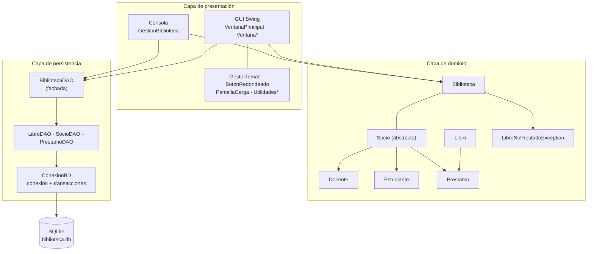
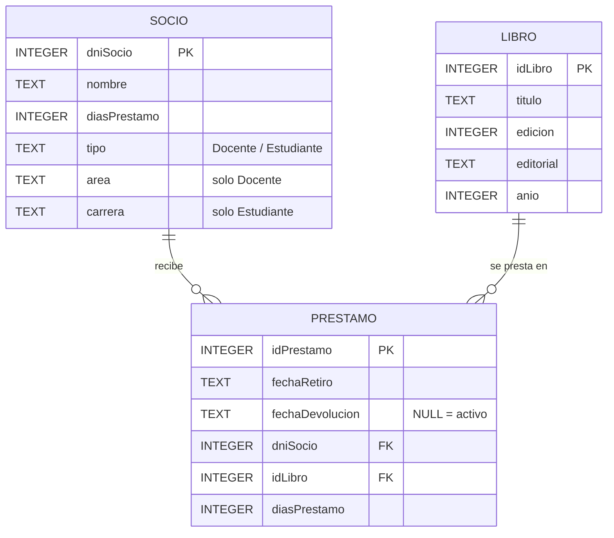
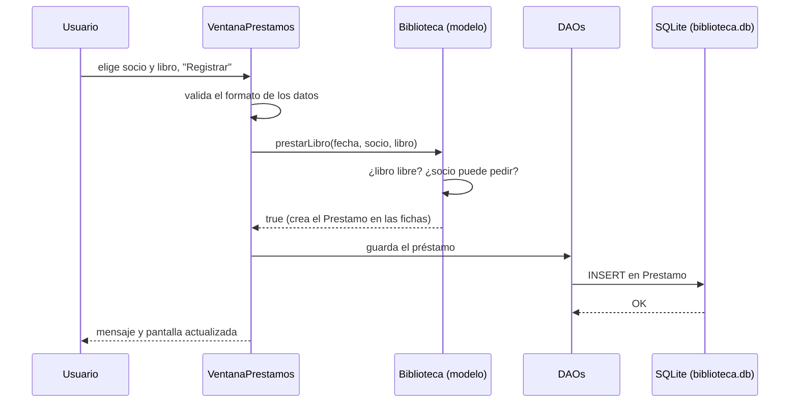

# Informe Técnico — MiBiblioteca (Gestión de Biblioteca)

> Trabajo Integrador de Programación Orientada a Objetos · TP7
> Java 21 · Java Swing · SQLite (JDBC) · BlueJ
> Equipo: Los NullPointerException · repositorio `integrador-poo` (rama `main`)

Este documento explica **cómo funciona el sistema**, capa por capa, con el
recorrido de los datos de punta a punta. Está pensado para la **defensa oral**:
cada sección cierra con los "puntos clave para explicar".

---

## Índice

1. [¿Qué hace el sistema?](#1-qué-hace-el-sistema)
2. [Arquitectura en capas](#2-arquitectura-en-capas)
3. [Capa de dominio](#3-capa-de-dominio)
4. [Capa de persistencia (SQLite + JDBC)](#4-capa-de-persistencia-sqlite--jdbc)
5. [Capa de presentación: GUI Swing](#5-capa-de-presentación-gui-swing)
6. [Capa de presentación: consola](#6-capa-de-presentación-consola)
7. [Recorrido completo de una operación](#7-recorrido-completo-de-una-operación)
8. [Cómo se corre el sistema](#8-cómo-se-corre-el-sistema)
9. [Casos de prueba](#9-casos-de-prueba)
10. [Decisiones de diseño y por qué](#10-decisiones-de-diseño-y-por-qué)
11. [Preguntas probables del tribunal](#11-preguntas-probables-del-tribunal)

---

## 1. ¿Qué hace el sistema?

Una biblioteca administra **libros (ejemplares), socios (docentes y
estudiantes) y préstamos**. El sistema implementagilas reglas de la consigna y le
suma persistencia real y una interfaz gráfica:

- **Reglas de negocio**: tope de libros para estudiantes, bloqueo ante préstamos
  vencidos, docentes responsables con premio de días e informes con formato.
- **Persistencia SQLite**: lo que se hace queda guardado en `biblioteca.db`.
- **GUI con Java Swing**: ventana principal con menú lateral y una pantalla por
  sección (Socios, Catálogo, Préstamos, Devoluciones, Estadísticas, Consultas).
- **Consola** (`GestionBiblioteca`): las operaciones también están disponibles
  en modo texto.

La GUI y la consola trabajan sobre **el mismo modelo y la misma base**: son dos
"caras" de la misma aplicación.

---

## 2. Arquitectura en capas

**Por qué está separada en capas**

- El **dominio** es el diseño pedido por la consigna: clases puras que no saben
  nada de SQL ni de Swing.
- La **persistencia** solo traduce objetos ↔ filas. Cambiar de motor de base de
  datos no toca el dominio.
- La **presentación** no escribe SQL: usa el modelo para las reglas y el DAO
  para guardar.

**Puntos clave para explicar**: *"Las reglas son del modelo; la base guarda; la
pantalla muestra. Cada capa solo conoce a la de abajo."*

---

## 3. Capa de dominio

Paquete `MiBiblioteca`, con colecciones genéricas (`ArrayList<Socio>`,
`ArrayList<Prestamo>`…).

| Clase | Qué representa |
|---|---|
| `Biblioteca` | Agregado raíz: nombre + colecciones de libros y socios. Concentra las operaciones (`prestarLibro`, `devolverLibro`, `buscarSocio`, `quitarSocio`, `quienTieneElLibro`, informes y listados). |
| `Socio` (abstracta) | DNI, nombre, días de préstamo y lista de préstamos. Define `puedePedir()` y `cantLibrosPrestados()`. |
| `Docente` | Agrega `area`, `esResponsable()` y el premio de días. |
| `Estudiante` | Agrega `carrera` y el tope de libros en su poder. |
| `Libro` | Ejemplar: título, edición, editorial, año y su ficha de préstamos. |
| `Prestamo` | Fecha de retiro, fecha de devolución, socio y libro. Sabe si está vencido y si está devuelto. |
| `LibroNoPrestadoException` | Excepción de negocio para devolver o consultar un libro que no está prestado. |

### Reglas de negocio

- **Días de préstamo**: docentes **5**, estudiantes **20**.
- **Tope del estudiante**: máximo **3** libros en su poder.
- **Bloqueo**: un socio con un préstamo vencido no puede pedir nuevos libros.
- **Un ejemplar, un préstamo activo**: no se presta un libro que ya está prestado.
- **Evaluación a nivel día**: las fechas se normalizan a medianoche. Un préstamo
  que vence **hoy** todavía está a tiempo y devolver el **mismo día** del
  vencimiento cuenta como devolución a tiempo.
- **Docente responsable**: nunca tuvo ni tiene un préstamo vencido. Los devueltos
  se evalúan contra su fecha de devolución y los activos contra hoy.
- **Premio**: `cambiarDiasDePrestamos(int)` suma días de préstamo al docente.
- **Rechazo silencioso**: `prestarLibro` devuelve `boolean`; quien llama decide
  qué mensaje mostrar.
- **Informe de vencidos**: considera solo préstamos **activos**.

**Puntos clave para explicar**: *"El modelo no imprime ni consulta la base: las
reglas funcionan igual desde la GUI y desde la consola."*

---

## 4. Capa de persistencia (SQLite + JDBC)

Motor: **SQLite** (un archivo, sin servidor) accedido por **JDBC** con el driver
`sqlite-jdbc` (carpeta `+libs/`).

### 4.1 `ConexionBD` — acceso único a la base

- Se construye con la ruta del archivo (`new ConexionBD("biblioteca.db")`) y la
  comparten todos los DAOs.
- `conectar()` abre `jdbc:sqlite:<ruta>` **solo si hace falta**: si ya hay una
  conexión abierta, devuelve la misma. Al abrir ejecuta
  `PRAGMA foreign_keys = ON` (sin eso SQLite **ignora** las claves foráneas).
- `cerrar()` cierra la conexión si está abierta.
- **`enTransaccion(TrabajoBD)`**: ejecuta un bloque de trabajo **todo o nada**.
  Desactiva el autoCommit, corre el trabajo y hace `COMMIT`; si algo falla hace
  `ROLLBACK` y relanza la excepción. Al terminar, salga como salga, restablece
  el autoCommit. Sirve para operaciones que tocan varias tablas.

### 4.2 Esquema de `biblioteca.db`

Tres tablas, creadas por `BibliotecaDAO.crearTablas()`:

| Tabla | Clave | Detalles |
|---|---|---|
| `Libro` | `idLibro` (AUTOINCREMENT) | Id artificial: los títulos pueden repetirse (varios ejemplares). |
| `Socio` | `dniSocio` (clave natural) | **Una sola tabla** para docentes y estudiantes, diferenciados por `tipo`. `area` es solo de docentes y `carrera` solo de estudiantes; la otra queda `NULL`. |
| `Prestamo` | `idPrestamo` (AUTOINCREMENT) | `fechaDevolucion NULL` = préstamo activo. Guarda `diasPrestamo`: los días que correspondían al socio al momento del préstamo. |

Reglas que defiende la base:

- **Claves foráneas** `Prestamo → Socio` y `Prestamo → Libro`, sin `ON DELETE
  CASCADE`: no se puede borrar un socio o libro con historial.
- **Índice parcial único** `idx_prestamo_activo_unico` sobre `Prestamo(idLibro)
  WHERE fechaDevolucion IS NULL`: un libro no puede tener **dos préstamos
  activos a la vez**, aunque el modelo falle.
- `NOT NULL` en los campos esenciales (`titulo`, `nombre`, `tipo`,
  `fechaRetiro`, `dniSocio`, `idLibro`).

### 4.3 Creación y migración: `crearTablas()`

Al arrancar, `BibliotecaDAO.crearTablas()` deja la base lista y **se puede correr
las veces que haga falta** (idempotente):

1. `CREATE TABLE IF NOT EXISTS` para las tres tablas.
2. **Migración de columna**: consulta `PRAGMA table_info(Prestamo)`; si falta
   `diasPrestamo`, la agrega con `ALTER TABLE`, y completa las filas viejas
   copiando los días del socio.
3. **Reparación de datos viejos**: `repararPrestamosDuplicados` busca libros con
   varios préstamos activos a la vez (un bug de versiones anteriores). Cierra los
   sobrantes con la fecha de retiro del préstamo siguiente y deja activo el más
   nuevo. **No borra datos** y avisa por consola de cada reparación.
4. **Índice único parcial**: recién entonces se crea. Si aun así falla, la
   aplicación **no se cae**: avisa y lista qué libros están en conflicto.

### 4.4 Los DAOs

Patrón **DAO** (Data Access Object): cada tabla tiene su clase de acceso, y
`BibliotecaDAO` las agrupa.

| Clase | Rol |
|---|---|
| `LibroDAO` | Acceso a la tabla `Libro` (`obtenerTodos()` y las operaciones de alta, baja y modificación). |
| `SocioDAO` | Acceso a `Socio`. Reconstruye la subclase correcta (`Docente` o `Estudiante`) según la columna `tipo`. |
| `PrestamoDAO` | Acceso a `Prestamo`. `cargarPrestamos(socios, libros)` lee las filas y **reenlaza cada préstamo** a la ficha de su libro y de su socio. |
| `BibliotecaDAO` | **Fachada**: construye los tres DAOs sobre la misma `ConexionBD`, crea las tablas y arma la `Biblioteca` completa con `cargarBiblioteca(nombre)`. |

> ⚠️ COMPLETAR: detallar los métodos de `LibroDAO`, `SocioDAO` y `PrestamoDAO`
> (insert / update / delete) y si usan `PreparedStatement` y `enTransaccion`.

`cargarBiblioteca(nombre)` hace, en orden: lee los **libros**, lee los
**socios**, carga los **préstamos** enlazándolos a ambos y devuelve
`new Biblioteca(nombre, libros, socios)`. Como las fechas se guardan como texto,
esta carga puede lanzar `ParseException`.

**Puntos clave para explicar**: *"La base defiende sus propias reglas (claves
foráneas e índice único), no solo el modelo. Y la migración está hecha para no
romper nunca datos ya guardados."*

---

## 5. Capa de presentación: GUI Swing

Interfaz hecha solo con **Java Swing** (JDK nativo, sin dependencias externas).

### 5.1 Arranque de la aplicación

El `main` de la GUI está en `VentanaPrincipal`. Hace, en este orden:

1. Crea la `ConexionBD("biblioteca.db")` y el `BibliotecaDAO`.
2. `crearTablas()` deja el esquema listo (y migra si hace falta).
3. `cargarBiblioteca("Biblioteca Gestion FACENA-UNNE")` arma el modelo desde la base.
4. Con `SwingUtilities.invokeLater` (la GUI se arma en el hilo de eventos de
   Swing) muestra la `PantallaCarga` y, al terminar, abre la `VentanaPrincipal`.

Si algo falla al iniciar, se informa el error por consola.

### 5.2 `VentanaPrincipal`: estructura

Es un `JFrame` (1300×850, mínimo 1000×650) con un `BorderLayout`:

| Zona | Contenido |
|---|---|
| **WEST** | Menú lateral con botones `BotonRedondeado`: Inicio, Socios, Catálogo, Préstamos, Devoluciones, Estadísticas, Consultas. |
| **NORTH** | Encabezado con el nombre de la biblioteca y el equipo. El botón **Tema** aparece solo en Inicio. |
| **CENTER** | `panelContenido`: acá se muestra la pantalla activa. |

**Navegación**: cada `Ventana*` es un `JPanel` que recibe `(biblioteca,
bibliotecaDAO, ventanaPrincipal)`. Al elegir una opción del menú,
`mostrarContenido(panel)` **reemplaza** el panel central (`removeAll` →
`add` → `revalidate` / `repaint`) sin tocar el menú ni el encabezado.

| Sección | Pantallas |
|---|---|
| Socios | `mostrarSocios()`: tarjetas → `VentanaSociosDocentes`, `VentanaSociosEstudiantes`, `VentanaListaSocios` y baja de socio |
| Catálogo | `VentanaCatalogo` (+ `VentanaGestionLibros`, `VentanaListaLibros`) |
| Préstamos | `VentanaPrestamos` |
| Devoluciones | `VentanaDevoluciones` |
| Estadísticas | `VentanaEstadisticas` (+ `VentanaInforme`) |
| Consultas | `VentanaConsultas` |

> ⚠️ COMPLETAR: confirmar qué hace exactamente `VentanaGestionLibros`,
> `VentanaListaLibros` e `VentanaInforme`.

`crearTarjeta(título, descripción, botón)` es un método público que arma las
tarjetas centradas (título, texto y botón) y se **reutiliza** desde otras
pantallas, como `VentanaCatalogo`.

### 5.3 Baja de socio (ejemplo de validación en la GUI)

Desde la tarjeta "Eliminar socio": **(1)** se pide el DNI con un `JOptionPane`;
**(2)** se valida que sea un número; **(3)** se busca con
`biblioteca.buscarSocio(dni)`; **(4)** se **bloquea** si el socio tiene algún
préstamo sin devolver, mostrando cuántos libros tiene; **(5)** recién entonces se
llama a `biblioteca.quitarSocio(socio)` y se informa el resultado.

> ⚠️ COMPLETAR: confirmar en qué punto se borra también la fila de la tabla
> `Socio`. En el código de `VentanaPrincipal` solo se ve la baja en el modelo; si
> `quitarSocio` no llama al `SocioDAO`, el socio reaparece al reiniciar.

### 5.4 Temas visuales: `GestorTemas`

`GestorTemas` guarda el tema activo (0–3) y un juego de colores por tema:

| N.º | Tema |
|---|---|
| 0 | Azul |
| 1 | Oscuro |
| 2 | Rosa |
| 3 | Rojo |

- `cambiarTema()` avanza al siguiente y vuelve a 0 después del último.
- `aplicarTema(Container)` **recorre recursivamente** todos los componentes y
  aplica los colores según su tipo: `BotonRedondeado` (colores normal, hover y
  presionado), `JButton`, `JLabel`, campos de texto y combos, `JTable` (con
  encabezado), `JPanel` y `JScrollPane`. También corrige el color del título de
  los bordes (`TitledBorder`), que en los temas oscuros quedaba invisible.
- Para los paneles usa `esColorClaro()`, que calcula la **luminosidad**
  (`0.299·R + 0.587·G + 0.114·B > 220`) y decide si el panel es "tarjeta" o
  "fondo".
- Al cambiar el tema, `VentanaPrincipal` actualiza todo y vuelve a Inicio.

### 5.5 Componentes de apoyo

- `BotonRedondeado`: botón propio con colores normal / hover / presionado.
- `PantallaCarga`: splash que se muestra mientras arranca la aplicación.
- `RenderizadorEstadoPrestamo`: dibuja el estado del préstamo en las tablas.
- `UtilidadesInterfaz` y `UtilidadesPrestamos`: funciones comunes de las pantallas.

**Puntos clave para explicar**: *"La ventana principal es un marco fijo (menú +
encabezado) y solo cambia el panel central. Los colores se aplican recorriendo
el árbol de componentes, así que cada pantalla nueva hereda el tema sin código
extra."*

---

## 6. Capa de presentación: consola

`GestionBiblioteca` es la clase principal del modo consola. Usa el mismo modelo
y la misma base que la GUI.

> ⚠️ COMPLETAR: describir qué operaciones ofrece el menú de consola y si
> incluye el escenario fijo de la consigna.

---

## 7. Recorrido completo de una operación

Ejemplo: registrar un préstamo desde la GUI hasta la fila guardada.

> ⚠️ COMPLETAR: ajustar el paso "guarda el préstamo" con el método exacto de
> `PrestamoDAO` y el orden real de las llamadas.

En palabras: **(1)** la vista valida el formato; **(2)** el modelo verifica las
reglas y, si se cumplen, crea el `Prestamo` y lo agrega a las fichas del libro y
del socio; **(3)** el DAO inserta la fila; **(4)** si el índice único o las
claves foráneas detectan una inconsistencia, la base **rechaza** la operación.
La devolución sigue el mismo camino, pero completando `fechaDevolucion` en la
fila existente.

**Puntos clave para explicar**: *"Hay dos defensas: el modelo valida primero y,
si algo se le escapa, la base lo frena."*

---

## 8. Cómo se corre el sistema

**Requisitos:** JDK 21 y BlueJ.

1. Abrir con BlueJ la carpeta `Tp7IntegradorBluej`.
2. Compilar. El driver `sqlite-jdbc-3.54.1.0.jar` está en `+libs/`, que BlueJ
   carga automáticamente.
3. Click derecho sobre la clase → `void main(String[] args)`:

| Modo | Clase |
|---|---|
| Consola | `GestionBiblioteca` |
| Interfaz gráfica (Swing) | `VentanaPrincipal` |

La base `biblioteca.db` se crea sola la primera vez. Para empezar de cero basta
con **borrar el archivo**: se reconstruye en el próximo arranque.

> ⚠️ COMPLETAR: indicar cómo usar `Tp7ProyectoEjecutable.jar` (clase principal
> y comando) y si se siembran datos iniciales con `CargadorDeDatosIniciales`.

---

## 9. Casos de prueba

Lista de verificaciones para recorrer el sistema (y para mostrar en la defensa):

- **Persistencia**: dar de alta un socio y un libro, cerrar y reabrir la
  aplicación; los datos siguen ahí.
- **Préstamo normal**: prestar un libro libre; aparece como prestado.
- **Libro ocupado**: intentar prestar un libro ya prestado; se rechaza.
- **Tope del estudiante**: con 3 libros, el cuarto se rechaza.
- **Bloqueo por vencido**: un socio con un préstamo vencido no puede pedir otro.
- **Devolución**: devolver el mismo día del vencimiento cuenta como a tiempo.
- **Docente responsable**: aparece en el informe solo si nunca tuvo vencidos; el
  premio suma días.
- **Integridad**: no se puede borrar un socio o libro con historial (clave
  foránea); un segundo préstamo activo del mismo libro lo frena el índice único.
- **Temas**: el botón Tema recorre los cuatro y todas las pantallas se actualizan.
- **Migración**: abrir una base de una versión anterior; `crearTablas()` la
  adapta sin perder datos.

---

## 10. Decisiones de diseño y por qué

| Decisión | Motivo |
|---|---|
| Patrón DAO + fachada `BibliotecaDAO` | Separar la persistencia del dominio y tener un único punto de carga. |
| `ConexionBD` reutiliza la conexión abierta | Una sola conexión para toda la app (SQLite serializa las escrituras). |
| `enTransaccion(TrabajoBD)` | Operaciones multi-tabla "todo o nada", con `ROLLBACK` ante errores. |
| `PRAGMA foreign_keys = ON` | SQLite no aplica las claves foráneas por defecto. |
| Tabla `Socio` única con discriminador `tipo` | Docentes y estudiantes comparten casi todo; evita dos tablas espejo. |
| Índice parcial único de préstamo activo | La base garantiza "un ejemplar, un préstamo activo". |
| Columna `diasPrestamo` en `Prestamo` | Cada préstamo recuerda los días que le correspondían al socio cuando se hizo. |
| `crearTablas()` idempotente con migración y reparación | Actualizar bases viejas sin perder datos ni romper el arranque. |
| Swing nativo | Sin dependencias extra: funciona con solo el JDK y BlueJ. |
| `GestorTemas` recursivo | Un tema nuevo o una pantalla nueva no requieren tocar cada componente. |
| Una ventana principal con panel central intercambiable | Menú y encabezado se mantienen; solo cambia el contenido. |

---

## 11. Preguntas probables del tribunal

**¿Por qué SQLite y no MySQL?**
El trabajo evalúa persistencia y diseño, no administrar un servidor. SQLite es un
archivo con SQL real, claves foráneas e índices. Con JDBC, cambiar de motor
afecta la URL y el esquema, no el diseño.

**¿Por qué Swing?**
Viene con el JDK: no hay dependencias externas y funciona directo desde BlueJ.

**¿Dónde están las reglas del negocio?**
En el dominio (`Biblioteca`, `Socio`, `Docente`, `Estudiante`, `Prestamo`). La
GUI solo muestra mensajes; la decisión la toma el modelo.

**¿Cómo se reconstruye el estado al abrir?**
`cargarBiblioteca()` lee libros y socios, y `cargarPrestamos()` reenlaza cada
préstamo a su libro y socio. Después el modelo opera igual que con objetos
recién creados.

**¿Qué es el índice parcial único?**
Un índice sobre `idLibro` que solo cuenta las filas con `fechaDevolucion NULL`:
impide dos préstamos activos del mismo libro, pero permite el historial.

**¿Se pueden borrar libros o socios con historial?**
No: las claves foráneas sin `CASCADE` lo impiden, y la GUI bloquea antes la baja
de un socio con libros prestados.

**¿Qué pasa si la base tiene datos de una versión anterior?**
`crearTablas()` agrega columnas faltantes, repara préstamos duplicados sin
borrar nada y recién después crea el índice único.

**¿Y si la base se borra?**
Se reconstruye sola con `crearTablas()`.

---

*Documento para la defensa del Trabajo Integrador — Los NullPointerException.*