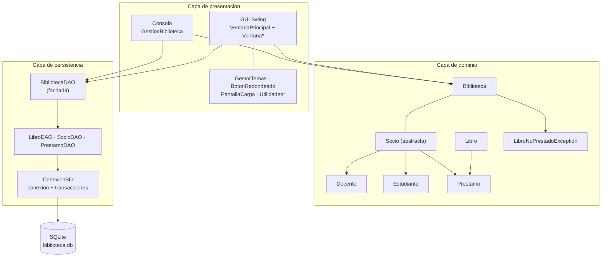
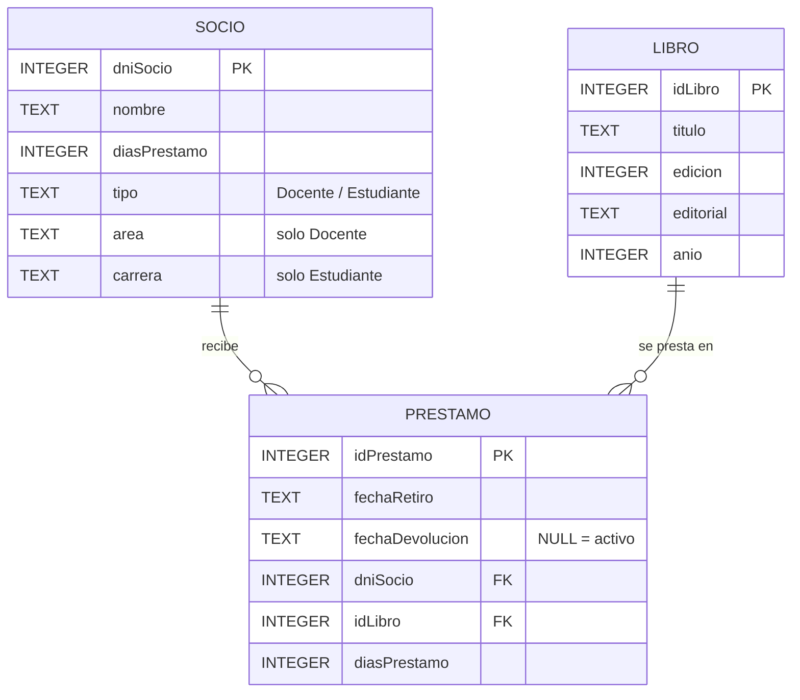
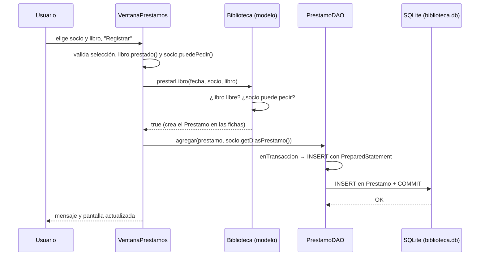

# Informe Técnico — biblioteca (Gestión de Biblioteca)

> Trabajo Integrador de Programación Orientada a Objetos · TP7
> Java 21 · Java Swing · SQLite (JDBC) · BlueJ
> Equipo: Los NullPointerException · repositorio `integrador-poo` (rama `main`)

Este documento explica **cómo funciona el sistema**, capa por capa, y sigue el
recorrido de los datos de punta a punta. Está pensado para la **defensa oral**:
cada sección cierra con una frase corta para explicar en voz alta.

---

## Índice

0. [Resumen en un minuto](#0-resumen-en-un-minuto)
1. [¿Qué hace el sistema?](#1-qué-hace-el-sistema)
2. [Arquitectura en capas](#2-arquitectura-en-capas)
3. [Capa de dominio](#3-capa-de-dominio)
4. [Capa de persistencia (SQLite + JDBC)](#4-capa-de-persistencia-sqlite--jdbc)
5. [Capa de presentación: GUI Swing](#5-capa-de-presentación-gui-swing)
6. [Capa de presentación: consola](#6-capa-de-presentación-consola)
7. [Recorrido completo de una operación](#7-recorrido-completo-de-una-operación)
8. [Cómo se corre el sistema](#8-cómo-se-corre-el-sistema)
9. [Casos de prueba](#9-casos-de-prueba)
10. [Decisiones de diseño y por qué](#10-decisiones-de-diseño-y-por-qué)
11. [Preguntas probables del tribunal](#11-preguntas-probables-del-tribunal)
12. [Limitaciones conocidas](#12-limitaciones-conocidas)

**Glosario rápido**

| Término | Significado en este proyecto |
|---|---|
| **DAO** | Clase que se encarga de leer y escribir una tabla de la base (Data Access Object). |
| **Ficha** | La lista de préstamos que guarda cada `Libro` y cada `Socio` en memoria. |
| **Préstamo activo** | Préstamo sin devolver (`fechaDevolucion` vacía). |
| **Clave foránea (FK)** | Regla de la base que obliga a que un dato apunte a algo que existe. |
| **Transacción** | Grupo de operaciones que se guardan todas juntas o no se guarda ninguna. |
| **Idempotente** | Que se puede ejecutar muchas veces y el resultado es el mismo. |

---

## 0. Resumen en un minuto

- Es un sistema de **gestión de biblioteca en Java** con dos interfaces: una
  **ventana gráfica (Swing)** y un **menú de consola**.
- Maneja **libros, socios (docentes y estudiantes) y préstamos**, con las
  reglas de la consigna.
- Los datos se guardan en **SQLite** y sobreviven al cerrar el programa.
- El código está en **tres capas**: dominio (las reglas), persistencia (la base)
  y presentación (las pantallas).
- La base **también se defiende sola**: no deja borrar datos con historial ni
  prestar un libro dos veces a la vez.

---

## 1. ¿Qué hace el sistema?

Una biblioteca administra **libros (ejemplares), socios (docentes y
estudiantes) y préstamos**. El sistema implementa las reglas de la consigna y le
suma persistencia real y una interfaz gráfica:

- **Reglas de negocio**: tope de libros para estudiantes, bloqueo ante préstamos
  vencidos, docentes responsables con premio de días e informes con formato.
- **Persistencia SQLite**: lo que se hace queda guardado en `biblioteca.db`.
- **GUI con Java Swing**: ventana principal con menú lateral y una pantalla por
  sección (Socios, Catálogo, Préstamos, Devoluciones, Estadísticas, Consultas).
- **Consola** (`GestionBiblioteca`): las operaciones también están disponibles
  en modo texto.

La GUI y la consola usan **el mismo modelo y la misma base**: son dos formas de
usar la misma aplicación.

---

## 2. Arquitectura en capas



**Por qué está separada en capas**

- El **dominio** es el diseño pedido por la consigna: clases que no saben nada
  de SQL ni de Swing.
- La **persistencia** solo traduce objetos a filas y viceversa. Cambiar de
  motor de base de datos no toca el dominio.
- La **presentación** no escribe SQL: usa el modelo para las reglas y el DAO
  para guardar.

**Para explicar**: *"Las reglas son del modelo, la base guarda y la pantalla
muestra. Cada capa solo conoce a la de abajo."*

---

## 3. Capa de dominio

Todo está en el paquete `biblioteca`, con colecciones genéricas
(`ArrayList<Socio>`, `ArrayList<Prestamo>`…).

| Clase | Qué representa |
|---|---|
| `Biblioteca` | Clase central: nombre + listas de libros y socios. Concentra las operaciones (`prestarLibro`, `devolverLibro`, `buscarSocio`, `quitarSocio`, `quienTieneElLibro`, informes y listados). |
| `Socio` (abstracta) | DNI, nombre, días de préstamo y lista de préstamos. Define `puedePedir()` y `cantLibrosPrestados()`. |
| `Docente` | Agrega `area`, `esResponsable()` y el premio de días. |
| `Estudiante` | Agrega `carrera` y el tope de libros en su poder. |
| `Libro` | Un ejemplar: título, edición, editorial, año y su ficha de préstamos. |
| `Prestamo` | Fecha de retiro, fecha de devolución, socio y libro. Sabe si está vencido y si está devuelto. |
| `LibroNoPrestadoException` | Error de negocio: se lanza al devolver o consultar un libro que no está prestado. |

### Reglas de negocio

| Regla | Detalle |
|---|---|
| Días de préstamo | Docentes **5**, estudiantes **20**. |
| Tope del estudiante | Máximo **3** libros en su poder. |
| Bloqueo por vencido | Un socio con un préstamo vencido no puede pedir libros nuevos. |
| Un ejemplar, un préstamo activo | No se presta un libro que ya está prestado. |
| Fechas por día | Las fechas se normalizan a medianoche. Un préstamo que vence **hoy** todavía está a tiempo, y devolverlo **el mismo día** del vencimiento cuenta como a tiempo. |
| Docente responsable | Nunca tuvo ni tiene un préstamo vencido. Los devueltos se miden contra su fecha de devolución; los activos, contra hoy. |
| Premio | `cambiarDiasDePrestamos(int)` suma días de préstamo al docente. La opción 14 del menú y el botón "Premiar responsables" de la GUI lo aplican a los docentes responsables y persisten el cambio. |
| Rechazo silencioso | `prestarLibro` devuelve `boolean`. Quien lo llama decide qué mensaje mostrar. |
| Informe de vencidos | Cuenta solo préstamos **activos**. |

**Para explicar**: *"El modelo no imprime ni consulta la base, por eso las reglas
funcionan igual desde la GUI y desde la consola."*

---

## 4. Capa de persistencia (SQLite + JDBC)

El motor es **SQLite** (un solo archivo, sin servidor), accedido con **JDBC** a
través del driver `sqlite-jdbc` (carpeta `+libs/`).

### 4.1 `ConexionBD`: el único acceso a la base

- Se crea con la ruta del archivo (`new ConexionBD("biblioteca.db")`) y la
  comparten todos los DAOs.
- `conectar()` registra el driver explícitamente con
  `Class.forName("org.sqlite.JDBC")` antes de abrir `jdbc:sqlite:<ruta>`. Si el
  jar del driver no está en el classpath, falla ahí con un mensaje claro
  (suele pasar si se abre en BlueJ la subcarpeta `biblioteca` en lugar del
  proyecto `Tp7IntegradorBluej`, que tiene el driver en `+libs/`).
- `conectar()` abre la conexión **solo si hace falta**. Si ya hay una
  conexión abierta, devuelve esa misma.
- Al abrir ejecuta `PRAGMA foreign_keys = ON`. Sin eso, SQLite **ignora** las
  claves foráneas.
- `cerrar()` cierra la conexión si está abierta.
- `enTransaccion(TrabajoBD)` ejecuta un bloque de trabajo **todo o nada**:
  1. desactiva el autoCommit;
  2. corre el trabajo y hace `COMMIT`;
  3. si algo falla, hace `ROLLBACK` y vuelve a lanzar el error;
  4. al terminar, salga como salga, restablece el autoCommit.

### 4.2 Esquema de `biblioteca.db`

Son tres tablas, creadas por `BibliotecaDAO.crearTablas()`:



| Tabla | Clave | Detalles |
|---|---|---|
| `Libro` | `idLibro` (autogenerado) | Id artificial, porque los títulos pueden repetirse (varios ejemplares). |
| `Socio` | `dniSocio` (clave natural) | **Una sola tabla** para docentes y estudiantes, separados por `tipo`. `area` es solo de docentes y `carrera` solo de estudiantes; la otra queda `NULL`. |
| `Prestamo` | `idPrestamo` (autogenerado) | `fechaDevolucion` vacía significa préstamo activo. Guarda `diasPrestamo`: los días que tenía el socio **cuando se hizo el préstamo**. |

**Reglas que defiende la propia base**

- **Claves foráneas** de `Prestamo` hacia `Socio` y `Libro`, sin `ON DELETE
  CASCADE`: no se puede borrar un socio ni un libro que tenga historial.
- **Índice único parcial** `idx_prestamo_activo_unico` sobre
  `Prestamo(idLibro) WHERE fechaDevolucion IS NULL`: un libro no puede tener
  **dos préstamos activos a la vez**, aunque el modelo falle.
- **`NOT NULL`** en los campos esenciales (`titulo`, `nombre`, `tipo`,
  `fechaRetiro`, `dniSocio`, `idLibro`).

### 4.3 Creación y migración: `crearTablas()`

Se ejecuta al arrancar y **se puede correr cuantas veces haga falta**
(idempotente). Hace cuatro pasos:

1. **Crea las tablas** si no existen (`CREATE TABLE IF NOT EXISTS`).
2. **Migra la columna `diasPrestamo`**: mira `PRAGMA table_info(Prestamo)`. Si
   falta, la agrega con `ALTER TABLE` y completa las filas viejas copiando los
   días del socio.
3. **Repara datos viejos**: `repararPrestamosDuplicados` busca libros con varios
   préstamos activos a la vez (un error de versiones anteriores). Cierra los
   sobrantes usando la fecha de retiro del préstamo siguiente y deja activo el
   más nuevo. **No borra datos** y avisa por consola cada reparación.
4. **Crea el índice único parcial**. Si todavía falla, la aplicación **no se
   cae**: avisa y lista qué libros están en conflicto.

### 4.4 Los DAOs

Cada tabla tiene su DAO. `BibliotecaDAO` es la **fachada**: crea los tres sobre
la misma `ConexionBD`, crea las tablas y arma la `Biblioteca` completa.

#### `LibroDAO`

Guarda en memoria un `HashMap<Libro, Integer>` que relaciona cada objeto `Libro`
con su `idLibro`.

| Método | Qué hace |
|---|---|
| `agregar(Libro)` | `INSERT` con `PreparedStatement`. Recupera el id generado y lo guarda en el mapa. |
| `obtenerTodos()` | `SELECT * FROM Libro`. Arma los `Libro` y registra sus ids en el mapa. |
| `obtenerIdentificador(Libro)` | Devuelve el id del mapa. Lo usa `PrestamoDAO` para armar la clave foránea. |
| `eliminar(Libro)` | `DELETE` por `idLibro`. Si el libro no tiene id conocido, lanza `SQLException`. |

#### `SocioDAO`

| Método | Qué hace |
|---|---|
| `agregar(Socio)` | `INSERT` con `PreparedStatement`. Decide el `tipo` con `instanceof` y completa `area` o `carrera` (la otra queda `NULL`). |
| `eliminar(Socio)` | `DELETE` por `dniSocio`. Devuelve cuántas filas borró. |
| `obtenerTodos()` | `SELECT * FROM Socio`. Crea un `Docente` o un `Estudiante` según la columna `tipo`. |

#### `PrestamoDAO`

Depende de `LibroDAO` para conocer el `idLibro`. Es **el único DAO que usa
`enTransaccion`**.

| Método | Qué hace |
|---|---|
| `agregar(Prestamo, int dias)` | `INSERT` dentro de una transacción. Si el índice único lo rechaza, hay `ROLLBACK` y el error sube a quien lo llamó. Existe una versión `agregar(Prestamo)` que toma los días del socio. |
| `actualizarDevolucion(Prestamo)` | `UPDATE` de `fechaDevolucion` solo sobre el préstamo activo, también dentro de una transacción. Devuelve la cantidad de filas: **0** significa que ese préstamo activo no existe en la base. |
| `obtenerDiasPrestamo(Prestamo)` | Busca el préstamo por socio + libro + fecha de retiro y devuelve los días que valían en ese momento. Si la fila no los tiene, usa los días actuales del socio. |
| `cargarPrestamos(socios, libros)` | `SELECT * FROM Prestamo`. Crea cada `Prestamo`, interpreta las fechas (formato `yyyy-MM-dd`) y lo agrega a la ficha de su socio y de su libro. |

#### Notas para la defensa

- Los inserts, updates y deletes usan **`PreparedStatement`**. Solo las
  consultas de "traer todo" usan `Statement` simple.
- **Casi no hay `update`**: el único es `SocioDAO.actualizarDiasPrestamo(Socio)`,
  que persiste el premio de días a los docentes responsables (opción 14 del
  menú y botón "Premiar responsables" de la GUI). Los datos de socios y libros
  no se editan: `LibroDAO` no tiene ningún `update`.
- **No hay `delete`** en `PrestamoDAO`: los préstamos son historial. No se
  borran: se les completa la fecha de devolución.
- `LibroDAO` y `SocioDAO` hacen operaciones de una sola sentencia y confían en el
  autoCommit. `PrestamoDAO` usa transacción porque sus operaciones deben ser
  "todo o nada".

### 4.5 Cargar la biblioteca: `cargarBiblioteca(nombre)`

Lee los **libros**, lee los **socios**, carga los **préstamos** (enlazándolos a
ambos) y devuelve `new Biblioteca(nombre, libros, socios)`. Como las fechas se
guardan como texto, esta carga puede lanzar `ParseException`.

**Para explicar**: *"La base defiende sus propias reglas (claves foráneas e
índice único), no solo el modelo. Y la migración está hecha para no romper nunca
datos ya guardados."*

---

## 5. Capa de presentación: GUI Swing

La interfaz usa solo **Java Swing** (parte del JDK, sin dependencias externas).

### 5.1 Arranque de la aplicación

El `main` de la GUI está en `VentanaPrincipal`. Hace, en este orden:

1. Crea la `ConexionBD("biblioteca.db")` y el `BibliotecaDAO`.
2. Llama a `crearTablas()`: deja el esquema listo y migra si hace falta.
3. Llama a `cargarBiblioteca("Biblioteca Gestion FACENA-UNNE")`: arma el modelo
   desde la base.
4. Con `SwingUtilities.invokeLater` (la GUI se arma en el hilo de eventos de
   Swing) muestra la `PantallaCarga` y, cuando termina, abre `VentanaPrincipal`.

Si algo falla al iniciar, el error se informa por consola.

### 5.2 `VentanaPrincipal`: estructura

Es un `JFrame` (1300×850, mínimo 1000×650) con un `BorderLayout`:

| Zona | Contenido |
|---|---|
| **WEST** | Menú lateral con botones `BotonRedondeado`: Inicio, Socios, Catálogo, Préstamos, Devoluciones, Estadísticas, Consultas. |
| **NORTH** | Encabezado con el nombre de la biblioteca y el equipo. El botón **Tema** aparece solo en Inicio. |
| **CENTER** | `panelContenido`: acá se muestra la pantalla activa. |

**Cómo se navega**: cada `Ventana*` es un `JPanel` que recibe `(biblioteca,
bibliotecaDAO, ventanaPrincipal)`. Al elegir una opción del menú,
`mostrarContenido(panel)` **reemplaza** el panel central (`removeAll`, `add`,
`revalidate`, `repaint`) sin tocar el menú ni el encabezado.

| Sección | Pantallas |
|---|---|
| Socios | `mostrarSocios()`: tarjetas hacia `VentanaSociosDocentes`, `VentanaSociosEstudiantes`, `VentanaListaSocios` y la baja de socio. `VentanaSociosDocentes` tiene además el botón "Premiar responsables", que premia y persiste |
| Catálogo | `VentanaCatalogo`, `VentanaGestionLibros`, `VentanaListaLibros` |
| Préstamos | `VentanaPrestamos` |
| Devoluciones | `VentanaDevoluciones` |
| Estadísticas | `VentanaEstadisticas`, `VentanaInforme` |
| Consultas | `VentanaConsultas` |

`crearTarjeta(título, descripción, botón)` es un método público que arma las
tarjetas centradas (título, texto y botón). Se **reutiliza** desde otras
pantallas, como `VentanaCatalogo`.

#### Las tres pantallas del catálogo y las estadísticas

**`VentanaGestionLibros`**: alta y baja de libros.

- Arriba hay un formulario (título, edición, editorial, año). Valida que los
  campos estén completos y que edición y año sean números. Si todo está bien,
  llama a `biblioteca.nuevoLibro(...)` y después a `LibroDAO.agregar(...)`.
- Abajo hay un combo con los ejemplares existentes para eliminar. Pide
  confirmación, ejecuta **primero** `LibroDAO.eliminar(libro)` y recién después
  quita el libro del modelo. Si la base rechaza el `DELETE` (el libro tiene
  préstamos asociados), avisa que no puede eliminarse.

**`VentanaListaLibros`**: vista de solo lectura del catálogo.

- Tiene un buscador por título que filtra **mientras se escribe** (usa un
  `DocumentListener` e ignora mayúsculas y minúsculas).
- Muestra una tarjeta por ejemplar (título, editorial, edición y año) y un
  contador "Libros encontrados: N".
- No consulta la base: lee los libros que ya están en el modelo.

**`VentanaInforme`**: genera el **informe general completo** como HTML dentro de
un `JTextPane`. Tiene 8 secciones:

1. Resumen general (socios, docentes, estudiantes, libros prestados y disponibles).
2. Lista de socios.
3. Lista de libros.
4. Títulos con su cantidad de ejemplares.
5. Docentes responsables.
6. Préstamos vencidos activos.
7. Historial completo de préstamos con su estado (activo, vencido sin devolver,
   devuelto a tiempo, fuera de término).
8. Resumen de préstamos.

Para calcular los vencimientos usa `PrestamoDAO.obtenerDiasPrestamo()`, así el
informe respeta los días que tenía cada socio **al momento del préstamo**.
Escapa los caracteres HTML de los textos, permite imprimir el informe
(`JTextPane.print()`) y volver a Estadísticas.

### 5.3 Baja de socio desde la GUI

Desde la tarjeta "Eliminar socio" el flujo es:

1. Se pide el DNI con un `JOptionPane`.
2. Se valida que sea un número.
3. Se busca con `biblioteca.buscarSocio(dni)`.
4. Se **bloquea** si el socio tiene préstamos sin devolver, y se informa cuántos
   libros tiene.
5. Si no hay problema, se llama a `biblioteca.quitarSocio(socio)` y se informa el
   resultado.

> ⚠️ **Limitación conocida** (detalle en la [sección 12](#12-limitaciones-conocidas)):
> este flujo **no borra la fila** del socio en la base, solo lo saca de la lista
> en memoria. La consola, en cambio, sí lo hace bien.

### 5.4 Temas visuales: `GestorTemas`

`GestorTemas` guarda el tema activo (0 a 3) y un juego de colores por tema:

| N.º | Tema |
|---|---|
| 0 | Azul |
| 1 | Oscuro |
| 2 | Rosa |
| 3 | Rojo |

- `cambiarTema()` pasa al siguiente y vuelve a 0 después del último.
- `aplicarTema(Container)` **recorre todos los componentes de la pantalla**
  (de forma recursiva) y les aplica los colores según su tipo: `BotonRedondeado`
  (colores normal, hover y presionado), `JButton`, `JLabel`, campos de texto y
  combos, `JTable` (con encabezado), `JPanel` y `JScrollPane`.
- También corrige el color de los títulos de borde (`TitledBorder`), que en los
  temas oscuros quedaban invisibles.
- Para decidir si un panel es "tarjeta" o "fondo", `esColorClaro()` calcula la
  **luminosidad** del color (`0.299·R + 0.587·G + 0.114·B`) y compara con 220.
- Al cambiar el tema, `VentanaPrincipal` actualiza todo y vuelve a Inicio.

### 5.5 Componentes de apoyo

| Clase | Para qué sirve |
|---|---|
| `BotonRedondeado` | Botón propio con colores normal, hover y presionado. |
| `PantallaCarga` | Pantalla de bienvenida mientras arranca la aplicación. |
| `RenderizadorEstadoPrestamo` | Dibuja el estado del préstamo en las tablas. |
| `UtilidadesInterfaz`, `UtilidadesPrestamos` | Funciones comunes que usan varias pantallas. |

**Para explicar**: *"La ventana principal es un marco fijo (menú y encabezado) y
solo cambia el panel del centro. Los colores se aplican recorriendo los
componentes, así que una pantalla nueva hereda el tema sin código extra."*

---

## 6. Capa de presentación: consola

`GestionBiblioteca` es la clase principal del modo consola. Usa el mismo modelo
y la misma base que la GUI.

**Arranque**: crea la `ConexionBD("biblioteca.db")` y el `BibliotecaDAO`,
ejecuta `crearTablas()` (antes de cargar, porque en la primera ejecución las
tablas todavía no existen) y carga el modelo con `cargarBiblioteca(...)`. Al
salir cierra la conexión con `conexionBD.cerrar()`.

**Menú** (se muestra al menos una vez; se sale con `0`):

| Opción | Operación |
|---|---|
| 1 | Agregar libro (título, edición, editorial, año). |
| 2 / 3 | Agregar socio docente / estudiante (DNI, nombre, área o carrera). |
| 4 | Prestar libro: pide DNI, título y **días transcurridos**. Con `10` simula un préstamo hecho hace 10 días; con `0` es hoy. |
| 5 | Devolver libro por título. |
| 6 | Cantidad de socios por tipo. |
| 7 | Préstamos vencidos. |
| 8 | Docentes responsables. |
| 9 | Consultar quién tiene un libro. |
| 10 / 11 / 12 | Listar socios / libros / títulos. |
| 13 | Eliminar socio: valida el DNI, bloquea si tiene préstamos activos y borra primero la fila de la base. |
| 14 | Premiar docentes responsables: suma 5 días de préstamo a cada responsable y persiste el cambio. Si la base rechaza, deshace el premio en memoria. |
| 0 | Salir. |

**Escenario de la consigna**: el menú es interactivo y **no carga datos por sí
solo**: trabaja sobre `biblioteca.db`, que viene incluida en el repositorio
con el escenario de ejemplo ya cargado (6 libros con títulos repetidos,
3 docentes y 2 estudiantes, 8 préstamos de 2026 con vencidos y devoluciones
a tiempo). La opción 4 permite, además, reproducir los casos de la consigna a
mano: los "días transcurridos" sirven para fabricar préstamos vencidos y probar
el bloqueo de socios y el informe de vencidos.

**Orden de las operaciones** (la consola y la GUI siguen el mismo criterio):

- **Préstamos y devoluciones**: primero se cambia el modelo y después se guarda
  en la base. Si la base rechaza la operación (`SQLException`), se **deshace el
  cambio en memoria** para que modelo y base no queden distintos.
- **Bajas** (socios y libros): primero se borra en la base. Solo si eso sale
  bien se quita del modelo.

La lectura de números tolera texto inválido: `leerEntero` vuelve a preguntar.

---

## 7. Recorrido completo de una operación

Ejemplo: registrar un préstamo desde la GUI, hasta la fila guardada.



Paso a paso, con las llamadas de `VentanaPrestamos.registrarPrestamo()`:

1. **La vista** toma el socio y el libro de los combos y valida que haya
   selección, que `libro.prestado()` sea falso y que `socio.puedePedir()` sea
   verdadero.
2. **El modelo**: `biblioteca.prestarLibro(fecha, socio, libro)` vuelve a
   validar las reglas y, si se cumplen, crea el `Prestamo` y lo agrega a las
   fichas del libro y del socio.
3. **La base**: la vista toma el préstamo con `libro.ultimoPrestamo()` y lo
   guarda con `bibliotecaDAO.getPrestamoDAO().agregar(prestamo,
   socio.getDiasPrestamo())`, que hace el `INSERT` dentro de `enTransaccion`.
4. **Si la base falla** (por ejemplo, el índice único detecta un segundo
   préstamo activo), la vista **deshace en memoria** el préstamo que agregó el
   modelo (lo quita de las fichas) y muestra el error.

**La devolución** sigue el mismo camino: `biblioteca.devolverLibro(libro)` en el
modelo y `PrestamoDAO.actualizarDevolucion(prestamo)` en la base. Si el `UPDATE`
afecta **0 filas** (el préstamo activo no estaba en la base), la vista deshace
la devolución en memoria.

**Para explicar**: *"Hay dos defensas: el modelo valida primero y, si algo se le
escapa, la base lo frena."*

---

## 8. Cómo se corre el sistema

**Requisitos:** JDK 21 y BlueJ.

### Desde BlueJ

1. Abrir con BlueJ la carpeta `Tp7IntegradorBluej`.
2. Compilar. El driver `sqlite-jdbc-3.54.1.0.jar` está en `+libs/`, y BlueJ lo
   carga automáticamente.
3. Click derecho sobre la clase y elegir `void main(String[] args)`:

| Modo | Clase |
|---|---|
| Consola | `GestionBiblioteca` |
| Interfaz gráfica (Swing) | `VentanaPrincipal` |

La base `biblioteca.db` se crea sola la primera vez. Para empezar de cero,
**borrar el archivo**: se reconstruye en el próximo arranque.

### Desde `Tp7ProyectoEjecutable.jar`

El jar incluye las clases de `biblioteca` y el driver de SQLite, así que no
necesita `+libs/`.

```bash
cd Tp7IntegradorBluej

# Interfaz gráfica (es la clase principal del jar)
java -jar Tp7ProyectoEjecutable.jar

# Consola (hay que indicar la clase)
java -cp Tp7ProyectoEjecutable.jar biblioteca.GestionBiblioteca
```

En ambos casos `biblioteca.db` se crea en la **carpeta desde donde se ejecuta
el comando**.

### Datos iniciales

Los datos del escenario de la consigna ya están cargados en `biblioteca.db`
(distribuida con el repositorio). Si la base se elimina, el programa la
recrea **vacía** y se la puebla desde el menú: la opción 1 agrega libros, la
2 y 3 socios, y la opción 4 registra préstamos (con los "días transcurridos"
para simular fechas pasadas). Al finalizar la sesión todo queda guardado en
la base.

---

## 9. Casos de prueba

Lista para recorrer el sistema (y para mostrar en la defensa):

| Caso | Qué debería pasar |
|---|---|
| **Persistencia** | Dar de alta un socio y un libro, cerrar y reabrir: los datos siguen. |
| **Préstamo normal** | Se presta un libro libre y aparece como prestado. |
| **Libro ocupado** | Intentar prestar un libro ya prestado se rechaza. |
| **Tope del estudiante** | Con 3 libros en su poder, el cuarto se rechaza. |
| **Bloqueo por vencido** | Un socio con un préstamo vencido no puede pedir otro. |
| **Devolución justo a tiempo** | Devolver el mismo día del vencimiento cuenta como a tiempo. |
| **Docente responsable** | Aparece en el informe solo si nunca tuvo vencidos; el premio suma días. |
| **Integridad de la base** | No se borra un socio ni un libro con historial (clave foránea). Un segundo préstamo activo del mismo libro lo frena el índice único. |
| **Temas** | El botón Tema recorre los cuatro y todas las pantallas se actualizan. |
| **Migración** | Abrir una base de una versión anterior: `crearTablas()` la adapta sin perder datos. |

---

## 10. Decisiones de diseño y por qué

| Decisión | Motivo |
|---|---|
| Patrón DAO + fachada `BibliotecaDAO` | Separar la persistencia del dominio y tener un único punto de carga. |
| `ConexionBD` reutiliza la conexión abierta | Una sola conexión para toda la app (SQLite serializa las escrituras). |
| `enTransaccion(TrabajoBD)` en `PrestamoDAO` | Préstamo y devolución son "todo o nada", con `ROLLBACK` si algo falla. |
| `PRAGMA foreign_keys = ON` | SQLite no aplica las claves foráneas por defecto. |
| Tabla `Socio` única con columna `tipo` | Docentes y estudiantes comparten casi todo; evita dos tablas casi iguales. |
| Índice único parcial de préstamo activo | La base garantiza "un ejemplar, un préstamo activo". |
| Columna `diasPrestamo` en `Prestamo` | Cada préstamo recuerda los días que correspondían al socio cuando se hizo. |
| `crearTablas()` idempotente, con migración y reparación | Actualizar bases viejas sin perder datos ni romper el arranque. |
| Swing nativo | Sin dependencias extra: funciona con solo el JDK y BlueJ. |
| `GestorTemas` recursivo | Una pantalla nueva o un tema nuevo no obligan a tocar cada componente. |
| Ventana principal con panel central intercambiable | Menú y encabezado se mantienen; solo cambia el contenido. |

---

## 11. Preguntas probables del tribunal

**¿Por qué SQLite y no MySQL?**
El trabajo evalúa persistencia y diseño, no administrar un servidor. SQLite es un
archivo con SQL real, claves foráneas e índices. Con JDBC, cambiar de motor
afecta la URL y el esquema, no el diseño.

**¿Por qué Swing?**
Viene con el JDK: no hay dependencias externas y funciona directo desde BlueJ.

**¿Dónde están las reglas del negocio?**
En el dominio (`Biblioteca`, `Socio`, `Docente`, `Estudiante`, `Prestamo`). La
GUI solo muestra mensajes; la decisión la toma el modelo.

**¿Cómo se reconstruye el estado al abrir?**
`cargarBiblioteca()` lee libros y socios, y `cargarPrestamos()` agrega cada
préstamo a la ficha de su libro y de su socio. Después el modelo opera igual que
con objetos recién creados.

**¿Qué es el índice único parcial?**
Un índice sobre `idLibro` que solo cuenta las filas con `fechaDevolucion` vacía:
impide dos préstamos activos del mismo libro, pero permite todo el historial.

**¿Se pueden borrar libros o socios con historial?**
No. Las claves foráneas sin `CASCADE` lo impiden, y la GUI bloquea antes la baja
de un socio con libros prestados.

**¿Qué pasa si la base es de una versión anterior?**
`crearTablas()` agrega las columnas que faltan, repara préstamos duplicados sin
borrar nada y recién después crea el índice único.

**¿Y si se borra la base?**
Se reconstruye sola con `crearTablas()`.

**¿Por qué los préstamos no se borran?**
Son historial. Sirven para saber si un docente es responsable y para el informe
general. Un préstamo terminado se marca con su fecha de devolución.

---

## 12. Limitaciones conocidas

**Baja de socio desde la GUI.** En `VentanaPrincipal`, el botón "Eliminar" llama
solo a `biblioteca.quitarSocio(socio)`, que hace `socios.remove(socio)` en la
lista en memoria. No llama a `SocioDAO.eliminar()`. Consecuencia: si se elimina
un socio desde la GUI y se reinicia la aplicación, **el socio reaparece**,
porque su fila sigue en la base.

La consola lo hace bien: ejecuta `SocioDAO.eliminar(socio)` primero y, solo si
no falla, llama a `biblioteca.quitarSocio(socio)`.

**Mejora pendiente**: que la GUI siga el mismo orden que la consola (primero la
base, después el modelo).

**Sin edición de datos.** `LibroDAO` no tiene `update`, y el único de
`SocioDAO` es `actualizarDiasPrestamo`, que aplica el premio a docentes
responsables: para corregir un dato hay que dar de baja y de alta.

---

*Documento para la defensa del Trabajo Integrador — Los NullPointerException.*